# ARTLY — witryna w Astro: zmiana wyglądu na v2

**Wersja:** 2.0 · listopad 2026
**Podstawa:** brief „ARTLY – zmiany do wdrożenia” (Magdalena Dańko), slajdy 02–04 i 10–16.
**Zastępuje:** rozdziały 1, 3, 5, 6 i 12 (SEO) dokumentu `ARTLY_Astro_instrukcja.md` (v1). Struktura projektu, i18n i wdrożenie z v1 obowiązują dalej, chyba że ten dokument mówi inaczej.
**Logo:** nowy symbol ARTLY i pliki są w `../03_Symbol_ARTLY/`. W headerze zostaje logotyp ARTLY; symbol służy jako favicon, ikona w banerze aplikacji i grafika OG.

> **Wymóg odbioru:** strona ma odpowiadać referencji z dokładnością **±2 px**. Dotyczy to pozycji i rozmiaru każdego elementu z pliku `spec/*.json` przy szerokościach **1440 px** (desktop) i **390 px** (mobile). Kolory, fonty, rozmiary i grubości czcionek muszą być zgodne 1:1. Szczegóły w §10.

---

## ⚑ STYL v2 = REFERENCJA DLA CAŁEJ WITRYNY (także stron, których nie ma w projekcie)

Ten dokument i screenshoty to **wzorzec stylu dla każdej strony ARTLY**, nie tylko dla strony głównej. Każda podstrona, której nie ma w projekcie, ma wyglądać tak, jakby była jego częścią. Dotyczy to m.in.:
- listy dzieł, karty dzieła, listy artystów i profilu artysty,
- koszyka i zamówienia, konta, logowania i rejestracji,
- pomocy, FAQ, regulaminu i polityki prywatności,
- stron błędów 404/500, strony „Aplikacja”, maili transakcyjnych i landing page'y kampanii.

Zasady dla stron bez projektu:

1. **Te same tokeny (§3), bez wyjątków.** Kolory tylko z palety: biel, `#111111`, `#F3EFE9`/`#F7F5F1`, szarości tekstu i linie. Fonty: Italiana (tylko logo), Newsreader (nagłówki), Hanken Grotesk (UI). `border-radius: 0`. Bez gradientów, cieni i kolorów akcentu.
2. **Te same komponenty.** Używaj gotowych elementów, nie twórz nowych wariantów:

   | Element | Wzór |
   |---|---|
   | Header i stopka | §6.1, §6.8 |
   | Przyciski | czarny pełny, obrysowy, link podkreślony |
   | Karta dzieła | §6.5 |
   | Karta artykułu | §6.6 |
   | Kafel ze zdjęciem | §6.3 |
   | Pasek informacyjny | §6.7 |
   | Pola formularzy, chipy, arkusze, toasty | `02_Aplikacja_Web_Mobile` §4 |
3. **Ta sama siatka i rytm.**
   - Kontener 1344 px, gutter 48/20.
   - Odstępy między sekcjami: 64 / 72 / 96 / 112 px na desktopie, 36 / 48 / 56 na mobile.
   - Nagłówek sekcji: H2 44/32 px + link „Zobacz wszystkie →” po prawej.
4. **Te same proporcje typografii.** Na stronę jeden H1 (64 lub 48 px na desktopie, 42 lub 34 px na mobile). H2 44/32, H3 24–26. Tekst 16–17 px, interlinia 1,55–1,65, szerokość akapitu max 720 px.
5. **Wzory układów dla typowych stron:**

   | Typ strony | Układ |
   |---|---|
   | Lista (dzieła, artyści, wyniki wyszukiwania) | jak „Ostatnio dodane”: siatka 4–5 kolumn na desktopie, 2 kolumny na mobile, filtry jako chipy (aplikacja A02) |
   | Szczegóły (dzieło, artysta) | galeria po lewej 7/12, informacje i CTA po prawej 5/12; na mobile jak aplikacja A03 |
   | Treść (Inspiracje, pomoc, regulamin) | jak artykuł A07: kolumna 720 px, zdjęcie nad tytułem, H2 jako śródtytuły |
   | Formularze (logowanie, checkout, kontakt) | kolumna 480 px, pola 48 px wysokości, przycisk główny na pełną szerokość |
   | Stany puste i błędy | tytuł Newsreader + jedno zdanie + jeden czarny przycisk; bez ilustracji i ikon dekoracyjnych |
6. **Ruch jak w §7.** Fade-up przy wejściu, zoom zdjęć przy hover, nic więcej.
7. **Zgodność.** Strona bez projektu nie ma pliku spec, więc nie podlega testowi ±2 px dla całej strony. Wspólne elementy (header, stopka, karty, przyciski, baner aplikacji) muszą jednak mieć **identyczne wymiary jak w spec** (±2 px) na każdej podstronie.
8. **Wątpliwości.** Gdy czegoś nie da się wyprowadzić z tych zasad, zapytaj projektanta przed wdrożeniem. Nie dodawaj elementów spoza systemu.

---

## Spis treści

0. [Co się zmienia – w skrócie](#0-co-się-zmienia--w-skrócie)
1. [Zawartość folderu](#1-zawartość-folderu)
2. [Zasady wizualne z briefu](#2-zasady-wizualne-z-briefu)
3. [Krok 1 – tokeny (podmień `tokens.css`)](#3-krok-1--tokeny)
4. [Krok 2 – co usunąć ze strony głównej](#4-krok-2--co-usunąć)
5. [Krok 3 – nowa struktura komponentów](#5-krok-3--struktura-komponentów)
6. [Krok 4 – sekcja po sekcji (ze screenshotami i wymiarami)](#6-krok-4--sekcja-po-sekcji) – w tym 6.0 baner aplikacji
7. [Krok 5 – ruch i animacje](#7-krok-5--ruch-i-animacje)
8. [Krok 6 – breakpointy](#8-krok-6--breakpointy)
9. [Krok 7 – nowa sekcja „Inspiracje” (blog) i SEO](#9-krok-7--inspiracje-i-seo)
   - [9a. SEO całej witryny](#9a-seo-całej-witryny-obowiązkowe)
10. [Weryfikacja ±2 px](#10-weryfikacja-2-px)
11. [Checklista odbioru](#11-checklista-odbioru)

---

## 0. Co się zmienia – w skrócie

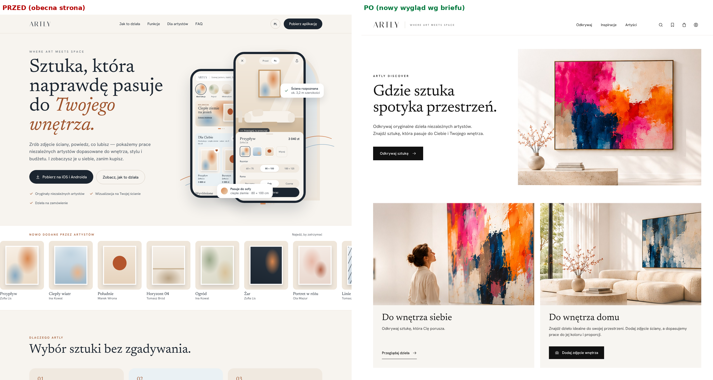

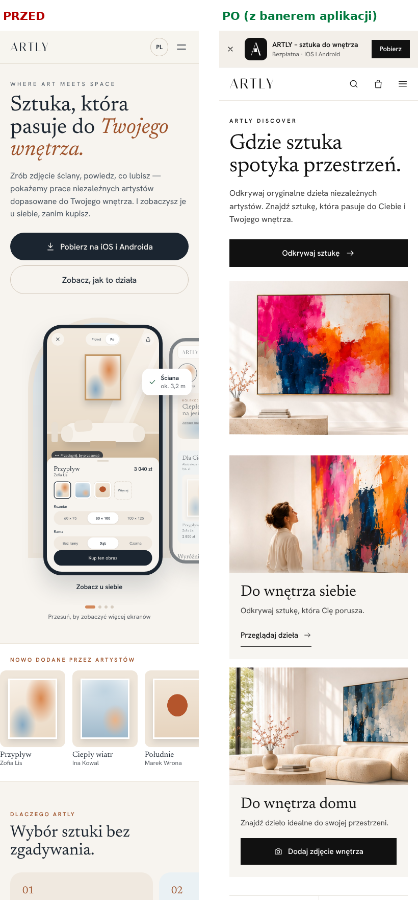

| Obszar | Było (v1) | Jest (v2) |
|---|---|---|
| Kolory | krem `#F7F4EF`, granat `#1B2530`, terakota `#D2885A` | biel `#FFFFFF`, czerń `#111111`, delikatny beż `#F3EFE9` / `#F7F5F1` |
| Ozdobniki | łuki, wstęgi SVG, gradienty, cienie, telefony w hero | brak – duże fotografie, przestrzeń, typografia |
| Przyciski | zaokrąglone „pigułki” | prostokątne, czarne, bez zaokrągleń (`border-radius: 0`) |
| Menu | Jak to działa · Funkcje · Dla artystów · FAQ + „Pobierz aplikację” | **Odkrywaj · Inspiracje · Artyści** + ikony: szukaj, zapisane, koszyk, konto |
| Hero | „Sztuka, która naprawdę pasuje…”, 2 CTA, mockupy telefonów | **ARTLY DISCOVER – „Gdzie sztuka spotyka przestrzeń.”**, jedno CTA **„Odkrywaj sztukę”**, zdjęcie wnętrza w marginesach |
| Pod hero | marquee, Dlaczego, Jak to działa, Funkcje, Lokalnie, FAQ… | **2 równe kafle** → **4 korzyści** → **Ostatnio dodane** → **Inspiracje** → **Dla artystów** → stopka |
| Kolekcje kuratorskie | na stronie głównej | **usunięte ze strony głównej** (są w Odkrywaj → „Wybrane przez ARTLY”) |

---

## 1. Zawartość folderu

```
01_Witryna_Astro/
├── INSTRUKCJA_Astro_nowy_wyglad.md      ← ten plik
├── screenshots/
│   ├── porownanie/   desktop_przed_po_gora.png, mobile_przed_po_gora.png
│   ├── pelne/        W01_desktop, W02_mobile (pierwsza wizyta, z banerem aplikacji),
│   │                 W02b_mobile_po_zamknieciu_banera, W03_mobile_menu, W04_mobile_baner_aplikacji  (@1x i @2x)
│   ├── sekcje/       01_header … 08_stopka  (_desktop i _mobile)
│   └── redline/      te same widoki z ramkami i wymiarami elementów
├── spec/             W01_desktop.json, W02_mobile.json, W02b_…json, W03_mobile_menu.json, W04_…json
├── public/           favicon.svg, favicon.ico, apple-touch-icon-180.png (nowy symbol ARTLY)
├── assets/           zdjęcia przykładowe (tymczasowe – patrz §6.10)
└── tools/            compare-web.mjs + compare-lib.mjs (test ±2 px)
```

- **`@1x` = referencja do pomiaru.** 1 px obrazu = 1 px CSS. Na tych plikach porównujesz implementację.
- **`@2x`** służy tylko do oglądania detali.
- **`spec/*.json`** to wymiary wyciągnięte z projektu. Dla każdego elementu masz `id`, `x`, `y`, `w` i `h` (względem lewego górnego rogu strony), a także font, kolor, tło, obramowanie, zaokrąglenie i padding. Z tych liczb korzysta test (§10).
- **Źródło prawdy:** canvas ARTLY, artboardy *Strona — desktop (wg briefu)* i *Strona — mobile (wg briefu)*. Przy sprzeczności między tym plikiem a `spec/*.json` wygrywa `spec/*.json`.

---

## 2. Zasady wizualne z briefu

1. Biel lub złamana biel, czerń i bardzo delikatny beż. **Kolor dają wyłącznie prace artystów.**
2. Duże fotografie, dużo przestrzeni, czytelna typografia redakcyjna.
3. **Bez gradientów, ozdobnych ramek i nadmiaru ikon.** Ikony tylko liniowe, 1,5 px, w kolorze tekstu.
4. Równe marginesy, nic nie wystaje poza kontener.
5. Nazwa ARTLY i kierunek „Vogue × 1stDibs” zostają.
6. Obrazy z makiet to przykłady. Docelowo zastępuje je prawdziwy katalog.

---

## 3. Krok 1 – tokeny

Podmień całą zawartość `src/styles/tokens.css`. Usuń wszystkie stare zmienne: `--accent`, `--accent-text`, `--surface-sand`, `--surface-blue` i gradienty.

```css
/* src/styles/tokens.css — ARTLY v2 */
:root {
  /* kolory */
  --c-bg: #FFFFFF;          /* tło strony */
  --c-ink: #111111;         /* tekst, przyciski, ikony */
  --c-text-2: #3D3D3D;      /* akapity */
  --c-muted: #555555;       /* etykiety, eyebrow, kategorie */
  --c-muted-2: #666666;     /* nazwiska artystów, drobny tekst */
  --c-beige: #F3EFE9;       /* placeholder zdjęć, pasek „Dla artystów” */
  --c-beige-2: #F7F5F1;     /* tło kafli „Do wnętrza…” */
  --c-line: #ECE8E2;        /* linie header/stopka */
  --c-line-2: #E6E2DC;      /* separatory korzyści */
  --c-sep: #D9D4CC;         /* pionowa kreska przy logo */
  --c-hover: #2B2B2B;       /* hover przycisku */

  /* fonty */
  --f-logo: 'Italiana', serif;
  --f-display: 'Newsreader', Georgia, serif;
  --f-ui: 'Hanken Grotesk', system-ui, sans-serif;

  /* kontener */
  --container: 1344px;      /* szerokość treści na desktopie */
  --gutter: 48px;           /* desktop; mobile: 20px */

  /* kształt */
  --radius: 0;              /* wszystkie przyciski, karty, zdjęcia */
  --border: 1px solid var(--c-ink);

  /* ruch */
  --ease: cubic-bezier(.2,.7,.2,1);
}
```

Fonty ładujesz w `<head>` w `Base.astro`. Tych samych wag używa projekt:

```html
<link rel="preconnect" href="https://fonts.googleapis.com">
<link rel="preconnect" href="https://fonts.gstatic.com" crossorigin>
<link href="https://fonts.googleapis.com/css2?family=Italiana&family=Newsreader:ital,opsz,wght@0,6..72,400;0,6..72,500;1,6..72,400&family=Hanken+Grotesk:wght@400;500;600&display=swap" rel="stylesheet">
```

> W produkcji możesz hostować fonty lokalnie (`@fontsource/*`). Muszą to być te same pliki, inaczej nie zmieścisz się w ±2 px wysokości wierszy.

**Skala typografii** (wartości z `spec/*.json`):

| Rola | Desktop | Mobile |
|---|---|---|
| Logo | Italiana 34 px, `letter-spacing: .12em`, `line-height: 1` | Italiana 28 px, .12em |
| Tagline przy logo | Hanken 10 px, `.3em`, `#555` | – (tylko w menu) |
| Eyebrow („ARTLY DISCOVER”) | Hanken 600, 12 px, `.32em` | 600, 11 px, `.3em` |
| H1 hero | Newsreader 400, 64 px / 1.04, `letter-spacing: -.015em` | 42 px / 1.05, `-.01em` |
| H2 sekcji | Newsreader 400, 44 px / 1.1 | 32 px / 1.1 |
| H2 kafla | Newsreader 400, 38 px / 1.1 | 30 px / 1.1 |
| Akapit hero | Hanken 400, 18 px / 1.6, `#3D3D3D` | 16 px / 1.6 |
| Akapit | Hanken 400, 16–17 px / 1.55–1.6 | 15 px / 1.55–1.6 |
| Menu | Hanken 400, 15 px | 34 px Newsreader (menu pełnoekranowe) |
| Przycisk | Hanken 500, 15 px, `.02em` | 500, 15 px |
| Karta dzieła: tytuł / artysta / cena | 15 px 500 / 14 px `#666` / 15 px | 15 px 500 / 13 px / 14 px |

---

## 4. Krok 2 – co usunąć

Ze strony głównej usuń te komponenty z v1. Pliki możesz zostawić, jeśli przydadzą się na podstronach.

| Komponent v1 | Decyzja |
|---|---|
| `Hero.astro` z `ScreenRotator` (telefony), wstęgi SVG, łuk | **usuń**; nowy `Hero.astro` (§6.2) |
| `Marquee.astro` („Nowo dodane przez artystów”) | **usuń**; zastępuje go `RecentArtworks.astro` (§6.5) |
| `WhyArtly.astro`, `HowItWorks.astro` (stepper), `Features.astro` (zakładki) | **usuń z home**; treść przenieś na `/jak-to-dziala` (opcjonalnie) |
| `Local.astro` (język/lokalizacja), `Guarantees.astro`, `FAQ.astro`, `StickyCta.astro` | **usuń z home**; FAQ przenieś do `/pomoc` |
| Sekcja „Kolekcje kuratorskie” | **usuń z home**. Brief: dostępne tylko w Odkrywaj → „Wybrane przez ARTLY” |
| Przycisk „Pobierz aplikację” w headerze, przełącznik PL | **usuń z headera**; linki do sklepów są w stopce, język w stopce lub ustawieniach |
| `motion.css`: `gradientShift`, `ribbon`, `float`, `floatTilt`, `marquee`, `langIn` | **usuń**; nowy zestaw w §7 |

---

## 5. Krok 3 – struktura komponentów

```
src/
├── layouts/Base.astro               (fonty, tokens.css, motion.css, reveal.ts)
├── components/
│   ├── site/Header.astro            §6.1  (+ MobileMenu.astro)
│   ├── home/Hero.astro              §6.2
│   ├── home/EntryTiles.astro        §6.3
│   ├── home/Benefits.astro          §6.4
│   ├── home/RecentArtworks.astro    §6.5  (+ ArtworkCard.astro)
│   ├── home/InspirationsTeaser.astro §6.6 (+ ArticleCard.astro)
│   ├── home/ArtistBand.astro        §6.7
│   └── site/Footer.astro            §6.8
├── content/inspiracje/*.md          §9   (kolekcja treści)
├── pages/index.astro
├── pages/inspiracje/index.astro
└── pages/inspiracje/[slug].astro
```

`src/pages/index.astro`:

```astro
---
import Base from '../layouts/Base.astro';
import Header from '../components/site/Header.astro';
import Hero from '../components/home/Hero.astro';
import EntryTiles from '../components/home/EntryTiles.astro';
import Benefits from '../components/home/Benefits.astro';
import RecentArtworks from '../components/home/RecentArtworks.astro';
import InspirationsTeaser from '../components/home/InspirationsTeaser.astro';
import ArtistBand from '../components/home/ArtistBand.astro';
import Footer from '../components/site/Footer.astro';
---
<Base title="ARTLY – Gdzie sztuka spotyka przestrzeń" description="Oryginalne dzieła niezależnych artystów dopasowane do Ciebie i Twojego wnętrza.">
  <Header />
  <main id="top">
    <Hero />
    <EntryTiles />
    <Benefits />
    <RecentArtworks />
    <InspirationsTeaser />
    <ArtistBand />
  </main>
  <Footer />
</Base>
```

W `Base.astro` nadaj `<body data-testid="screen-root">`, bo test mierzy od lewego górnego rogu strony (§10).

Wspólny kontener (globalny CSS):

```css
.wrap { max-width: var(--container); margin: 0 auto; padding-left: var(--gutter); padding-right: var(--gutter); }
.ph { overflow: hidden; background: var(--c-beige); }
.ph img { display: block; width: 100%; height: 100%; object-fit: cover; transition: transform 1.1s var(--ease); }
.btn { display: inline-flex; align-items: center; gap: 14px; background: var(--c-ink); color: #fff;
       font: 500 15px/1 var(--f-ui); letter-spacing: .02em; text-decoration: none; transition: background .25s; }
.btn:hover { background: var(--c-hover); }
.arrow { transition: transform .3s ease; }
a:hover > .arrow, .btn:hover .arrow { transform: translateX(5px); }
@media (max-width: 1023px) { :root { --gutter: 20px; } }
```

> `max-width: 1344px` dotyczy **treści**, a `padding` dodaje się na zewnątrz (`box-sizing: content-box` na `.wrap`). Przy 1440 px treść zaczyna się na **x = 48**, kończy na **x = 1392**. To pierwszy punkt, który sprawdza test.

---

## 6. Krok 4 – sekcja po sekcji

Wymiary podane są w px przy 1440 / 390. **Pełną listę** ze współrzędnymi masz w `spec/W01_desktop.json` i `spec/W02_mobile.json`. Pole `id` = wartość `data-testid`, którą nadajesz elementowi, bez prefiksu `W01_desktop.` (np. `a.odkrywaj-sztuke`).

### 6.0 Baner pobierania aplikacji (tylko telefony)

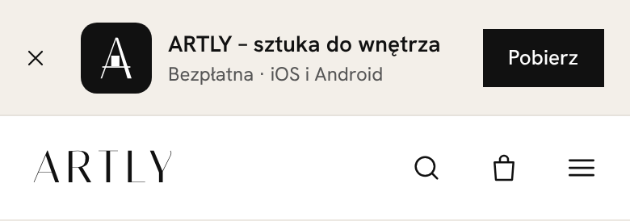

Na telefonie (szerokość < 1024 px i urządzenie dotykowe) nad headerem pokazuje się baner zachęcający do pobrania aplikacji. Na desktopie i tablecie poziomo baneru nie ma: linki do sklepów są w stopce.

**Wygląd** (wymiary z `spec/W04_mobile_baner_aplikacji.json`):

| Element | Spec |
|---|---|
| Pasek | wys. 72 px, tło `#F3EFE9`, dolna linia 1 px `#E6E2DC`, `padding: 0 16px 0 4px`, `gap: 10px`; **nie jest sticky**, przewija się ze stroną, a header pod nim pozostaje sticky |
| Zamknij | przycisk 36×44 na x 4, ikona X 16 px (stroke 1,6), `aria-label="Zamknij baner aplikacji"` |
| Ikona aplikacji | 44×44, `border-radius: 10px` (jedyny wyjątek od `radius 0`, bo to kształt ikony z systemu), tło `#111`, biały **nowy symbol ARTLY** 30 px (`03_Symbol_ARTLY/svg/artly-symbol-white.svg`) |
| Tekst | „ARTLY – sztuka do wnętrza” Hanken 600 14 px (ellipsis) + „Bezpłatna · iOS i Android” 12 px `#555`, odstęp 2 px |
| Przycisk | „Pobierz”: 75,5×36 na x 298,5, tło `#111`, Hanken 500 13 px, `padding: 0 16px` |
| Wejście | fade 0,4 s, bez przesuwania treści |

**Zachowanie:**

1. **Gdzie się pokazuje.** Na Androidzie (Chrome, Samsung Internet, Firefox) i na iOS w przeglądarkach innych niż Safari (Chrome, Firefox, Edge). W **iOS Safari** pokaż natywny Smart App Banner Apple zamiast własnego, żeby nie było dwóch banerów:
   ```html
   <meta name="apple-itunes-app" content="app-id=[APP_STORE_ID], app-argument=https://artly.pl{Astro.url.pathname}">
   ```
2. **Gdzie się nie pokazuje:**
   - w aplikacji ARTLY (WebView z `User-Agent` zawierającym `ArtlyApp`),
   - na stronie `/aplikacja`,
   - w koszyku i checkout,
   - gdy użytkownik zamknął baner w ciągu ostatnich 30 dni.
3. **Zamknięcie** zapisuje `localStorage['artly_appban_until'] = teraz + 30 dni`. Kliknięcie „Pobierz” ukrywa baner na 7 dni.
4. **Link „Pobierz”** prowadzi do `/app?src=web_banner&path=<bieżąca ścieżka>` (endpoint Astro). Endpoint rozpoznaje platformę po User-Agent i przekierowuje 302:
   - iOS → `https://apps.apple.com/app/id[APP_STORE_ID]`,
   - Android → `https://play.google.com/store/apps/details?id=pl.artly.app&referrer=utm_source%3Dweb_banner`,
   - inne → `/aplikacja`.

   Gdy aplikacja jest zainstalowana, Universal Links / App Links (`/.well-known/apple-app-site-association`, `/.well-known/assetlinks.json`) otwierają ją na tej samej treści, np. karcie dzieła.
5. **Bez przeskoku układu (CLS = 0).** Baner jest w HTML od początku. Skrypt inline w `<head>`, uruchamiany przed pierwszym renderem, dodaje klasę `no-appban` do `<html>`, gdy baneru nie należy pokazać. CSS ukrywa wtedy baner, zanim strona się narysuje. Nie wstawiaj baneru JavaScriptem po załadowaniu.
6. **SEO.** To mały pasek, który nie zasłania treści, więc spełnia wytyczne Google dotyczące reklam pełnoekranowych. **Nie** zamieniaj go na modal ani pełnoekranową planszę.
7. **Analityka:** zdarzenia `app_banner_view`, `app_banner_click`, `app_banner_close`.

```astro
---
// src/components/site/AppBanner.astro
const path = Astro.url.pathname;
---
<script is:inline>
  (function () {
    var d = document.documentElement, ua = navigator.userAgent, hide = false;
    try { hide = Date.now() < +(localStorage.getItem('artly_appban_until') || 0); } catch (e) {}
    var iosSafari = /iP(hone|od|ad)/.test(ua) && /Safari/.test(ua) && !/CriOS|FxiOS|EdgiOS/.test(ua);
    var mobile = matchMedia('(max-width: 1023px) and (pointer: coarse)').matches;
    if (hide || iosSafari || !mobile || /ArtlyApp/.test(ua) || /^\/(aplikacja|koszyk|checkout)/.test(location.pathname)) d.classList.add('no-appban');
  })();
</script>
<aside class="appban" aria-label="Aplikacja ARTLY" data-testid="aside.appban">
  <button class="appban__x" aria-label="Zamknij baner aplikacji" data-testid="button.zamknij-baner-aplikacji"><svg width="16" height="16" viewBox="0 0 24 24" fill="none" stroke="currentColor" stroke-width="1.6" stroke-linecap="round" aria-hidden="true"><path d="M6 6l12 12M18 6L6 18"/></svg></button>
  <span class="appban__icon"></span>
  <span class="appban__txt"><strong>ARTLY – sztuka do wnętrza</strong><span>Bezpłatna · iOS i Android</span></span>
  <a class="appban__cta" href={`/app?src=web_banner&path=${encodeURIComponent(path)}`} data-testid="a.pobierz">Pobierz</a>
</aside>
<style>
  .appban { height: 72px; box-sizing: border-box; display: flex; align-items: center; gap: 10px; padding: 0 16px 0 4px; background: var(--c-beige); border-bottom: 1px solid var(--c-line-2); animation: banIn .4s ease both; }
  :global(html.no-appban) .appban { display: none; }
  @media (min-width: 1024px) { .appban { display: none; } }
  @keyframes banIn { from { opacity: 0; } to { opacity: 1; } }
  @media (prefers-reduced-motion: reduce) { .appban { animation: none; } }
  .appban__x { width: 36px; height: 44px; flex-shrink: 0; display: flex; align-items: center; justify-content: center; border: 0; background: transparent; color: var(--c-ink); }
  .appban__icon { width: 44px; height: 44px; border-radius: 10px; background: var(--c-ink); display: flex; align-items: center; justify-content: center; flex-shrink: 0; }
  .appban__txt { flex-grow: 1; min-width: 0; display: flex; flex-direction: column; gap: 2px; }
  .appban__txt strong { font: 600 14px var(--f-ui); white-space: nowrap; overflow: hidden; text-overflow: ellipsis; }
  .appban__txt span { font: 400 12px var(--f-ui); color: var(--c-muted); }
  .appban__cta { flex-shrink: 0; height: 36px; padding: 0 16px; display: inline-flex; align-items: center; background: var(--c-ink); color: #fff; font: 500 13px var(--f-ui); text-decoration: none; }
</style>
<script>
  const ban = document.querySelector('.appban');
  const hideFor = (days) => { try { localStorage.setItem('artly_appban_until', String(Date.now() + days * 864e5)); } catch {} document.documentElement.classList.add('no-appban'); };
  ban?.querySelector('.appban__x')?.addEventListener('click', () => { hideFor(30); window.dataLayer?.push({ event: 'app_banner_close' }); });
  ban?.querySelector('.appban__cta')?.addEventListener('click', () => { hideFor(7); window.dataLayer?.push({ event: 'app_banner_click' }); });
  if (ban && !document.documentElement.classList.contains('no-appban')) window.dataLayer?.push({ event: 'app_banner_view' });
</script>
```

`AppBanner` wstawiasz w `Base.astro` jako pierwszy element `<body>`, przed `<Header />`.

```ts
// src/pages/app.ts — przekierowanie do sklepu
import type { APIRoute } from 'astro';
export const prerender = false;
export const GET: APIRoute = ({ request, url, redirect }) => {
  const ua = request.headers.get('user-agent') || '';
  const src = url.searchParams.get('src') || 'web';
  if (/iPhone|iPad|iPod/.test(ua)) return redirect(`https://apps.apple.com/app/id[APP_STORE_ID]?pt=[PROVIDER_ID]&ct=${src}`, 302);
  if (/Android/.test(ua)) return redirect(`https://play.google.com/store/apps/details?id=pl.artly.app&referrer=${encodeURIComponent('utm_source=' + src)}`, 302);
  return redirect('/aplikacja', 302);
};
```

### 6.1 Header

| Desktop | Mobile |
|---|---|
| 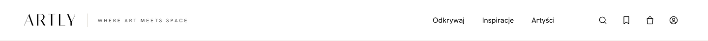 | 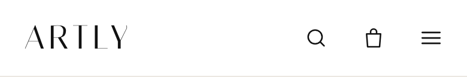 |

**Desktop:**
- Wysokość 84 px + linia 1 px `#ECE8E2`, `position: sticky; top: 0`.
- Tło `rgba(255,255,255,.94)` + `backdrop-filter: blur(10px)`.
- Lewa strona:
  - Logo ARTLY: x 48, y 25, blok logo + tagline 335,5×34.
  - Kreska 1×28 `#D9D4CC`, przerwa 20 px po obu stronach.
  - Tagline WHERE ART MEETS SPACE.
- Menu po prawej: Odkrywaj (x 880) · Inspiracje (x 980,5) · Artyści (x 1081). Linki 40 px wysokości, odstęp 36 px.
- Pod linkiem na hover rysuje się kreska 1 px od lewej (0,35 s).
- Ikony 44×44: szukaj, zapisane, koszyk, konto, na x 1204 / 1252 / 1300 / 1348, odstęp 4 px.
- Ikony SVG mają 20 px, `stroke-width: 1.5`. Hover: tło `#F3EFE9`.

**Mobile:**
- Wysokość 64 px + linia 1 px.
- Logo Italiana 28 px na x 20.
- Ikony 44×44: szukaj (x 242), koszyk (290), menu (338).
- Menu (W03): pełnoekranowa warstwa pod headerem (top 64, wysokość 640, padding 24/20):
  - Odkrywaj / Inspiracje / Artyści – Newsreader 34 px, wiersze z linią `#ECE8E2`.
  - Pod nimi linki z ikonami: „Zapisane i kolekcje”, „Konto”, każdy 52 px wysokości.
  - Na dole tagline.
  - Wejście: fade + przesunięcie −8 px, 0,3 s.
  - Ikona hamburgera zamienia się w X.

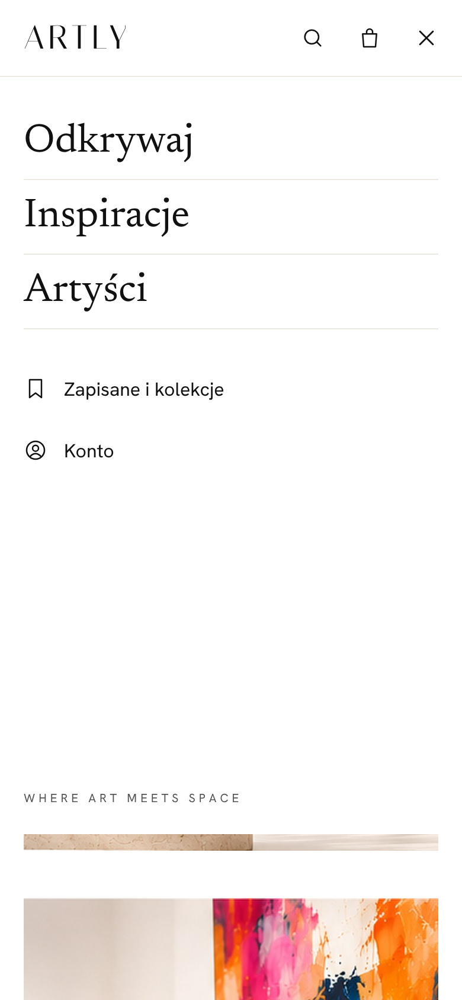

```astro
---
// src/components/site/Header.astro
const nav = [
  { href: '/odkrywaj', label: 'Odkrywaj' },
  { href: '/inspiracje', label: 'Inspiracje' },
  { href: '/artysci', label: 'Artyści' },
];
---
<header class="hdr">
  <div class="wrap hdr__in">
    <a href="/" class="logo" data-testid="a.artly-where-art-meets-space">
      <span class="logo__word">ARTLY</span><span class="logo__sep" aria-hidden="true"></span>
      <span class="logo__tag">WHERE ART MEETS SPACE</span>
    </a>
    <nav class="hdr__nav" aria-label="Główna" data-testid="nav.glowna">
      {nav.map(n => <a href={n.href} data-testid={`a.${n.label.toLowerCase().normalize('NFD').replace(/[̀-ͯ]/g,'')}`}>{n.label}</a>)}
    </nav>
    <div class="hdr__icons">
      <button class="ico" aria-label="Szukaj" data-testid="button.szukaj"><!-- svg 20 --></button>
      <a class="ico" href="/zapisane" aria-label="Zapisane" data-testid="button.zapisane"><!-- svg --></a>
      <a class="ico" href="/koszyk" aria-label="Koszyk" data-testid="button.koszyk"><!-- svg --></a>
      <a class="ico" href="/konto" aria-label="Konto" data-testid="button.konto"><!-- svg --></a>
      <button class="ico hdr__burger" aria-label="Menu" aria-expanded="false" data-testid="button.menu"><!-- svg --></button>
    </div>
  </div>
</header>
<style>
  .hdr { position: sticky; top: 0; z-index: 20; background: rgba(255,255,255,.94); backdrop-filter: blur(10px); border-bottom: 1px solid var(--c-line); }
  .hdr__in { height: 84px; display: flex; align-items: center; gap: 28px; }
  .logo { display: flex; align-items: center; gap: 20px; text-decoration: none; color: var(--c-ink); }
  .logo__word { font: 400 34px/1 var(--f-logo); letter-spacing: .12em; }
  .logo__sep { width: 1px; height: 28px; background: var(--c-sep); }
  .logo__tag { font: 400 10px var(--f-ui); letter-spacing: .3em; color: var(--c-muted); }
  .hdr__nav { margin-left: auto; margin-right: 20px; display: flex; gap: 36px; }
  .hdr__nav a { position: relative; padding: 10px 0; font: 400 15px var(--f-ui); color: var(--c-ink); text-decoration: none; }
  .hdr__nav a::after { content: ""; position: absolute; left: 0; right: 0; bottom: 4px; height: 1px; background: var(--c-ink); transform: scaleX(0); transform-origin: left; transition: transform .35s ease; }
  .hdr__nav a:hover::after { transform: scaleX(1); }
  .hdr__icons { display: flex; gap: 4px; }
  .ico { width: 44px; height: 44px; display: flex; align-items: center; justify-content: center; border: 0; background: transparent; color: var(--c-ink); }
  .ico:hover { background: var(--c-beige); }
  .hdr__burger { display: none; }
  @media (max-width: 1023px) {
    .hdr__in { height: 64px; gap: 4px; padding-right: 8px; }
    .logo__word { font-size: 28px; } .logo__sep, .logo__tag, .hdr__nav { display: none; }
    .hdr__icons { margin-left: auto; gap: 4px; }
    .hdr__icons [aria-label="Zapisane"], .hdr__icons [aria-label="Konto"] { display: none; }
    .hdr__burger { display: flex; }
  }
</style>
```

### 6.2 Hero

| Desktop | Mobile |
|---|---|
| 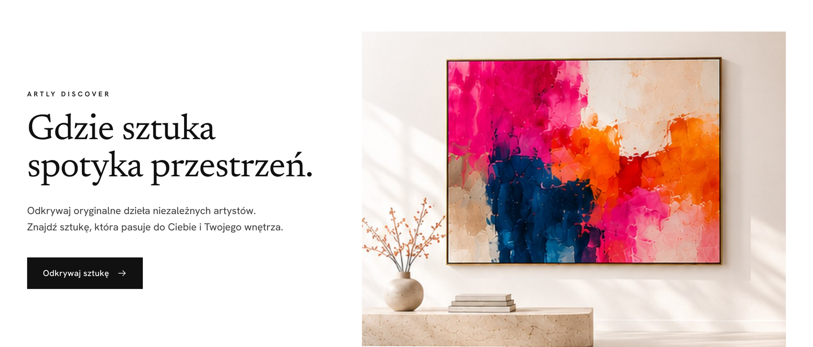 | 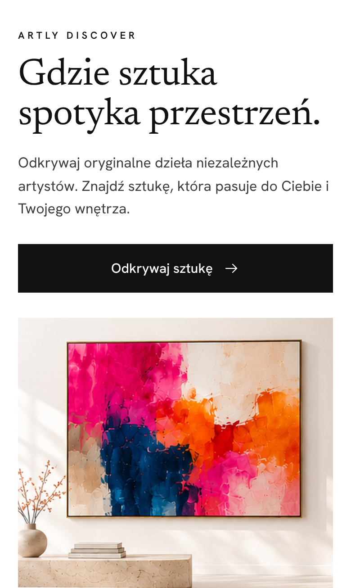 |

**Desktop:**
- `padding-top: 56px`, siatka `5fr 7fr`, `gap: 56px`, `align-items: center`.
- Lewa kolumna ma `padding: 24px 0`:
  - Eyebrow „ARTLY DISCOVER”.
  - H1 **„Gdzie sztuka spotyka przestrzeń.”**: x 48, y 283,5, 536,5×133.
  - Akapit, `margin-top: 28px`, `max-width: 460px`.
  - Przycisk **„Odkrywaj sztukę →”**, `margin-top: 40px`: 205,5×56, `padding: 0 28px`.
- Prawa kolumna: zdjęcie wnętrza 751,5×560 na x 640,5, y 141. Mieści się w kontenerze, **nie wystaje do krawędzi okna**.

**Mobile:**
- `padding: 32px 20px 0`.
- Kolejność: eyebrow → H1 (350×88, y 127) → akapit → przycisk na pełną szerokość 350×54 (y 336).
- Pod przyciskiem zdjęcie 350×300 (y 418).

**Treść (bez zmian słownych):**
- Akapit: „Odkrywaj oryginalne dzieła niezależnych artystów. Znajdź sztukę, która pasuje do Ciebie i Twojego wnętrza.”
- Zostaje jedno CTA. **Nie** dodawaj drugiego przycisku ani „Poznaj ARTLY”.

```astro
---
// src/components/home/Hero.astro
import { Image } from 'astro:assets';
import heroImg from '../../assets/home/hero-room.jpg';
---
<section class="wrap hero">
  <div class="hero__txt">
    <div class="eyebrow in">ARTLY DISCOVER</div>
    <h1 class="hero__h1 in d1" data-testid="h1.gdzie-sztuka-spotyka-przestrzen">Gdzie sztuka spotyka przestrzeń.</h1>
    <p class="hero__p in d2">Odkrywaj oryginalne dzieła niezależnych artystów. Znajdź sztukę, która pasuje do Ciebie i Twojego wnętrza.</p>
    <a href="/odkrywaj" class="btn hero__cta in d3" data-testid="a.odkrywaj-sztuke">Odkrywaj sztukę <svg class="arrow" width="18" height="18" viewBox="0 0 24 24" fill="none" stroke="currentColor" stroke-width="1.5" stroke-linecap="round" aria-hidden="true"><path d="M4 12h16M14 6l6 6-6 6"/></svg></a>
  </div>
  <div class="ph hero__img in d2" data-testid="img">
    <Image src={heroImg} alt="Jasne wnętrze z dużym abstrakcyjnym obrazem nad kamienną konsolą" class="zoom" loading="eager" fetchpriority="high" widths={[480, 960, 1500]} sizes="(min-width:1024px) 752px, 100vw" />
  </div>
</section>
<style>
  .hero { padding-top: 56px; display: grid; grid-template-columns: 5fr 7fr; gap: 56px; align-items: center; }
  .hero__txt { padding: 24px 0; }
  .eyebrow { font: 600 12px var(--f-ui); letter-spacing: .32em; }
  .hero__h1 { margin: 24px 0 0; font: 400 64px/1.04 var(--f-display); letter-spacing: -.015em; }
  .hero__p { margin: 28px 0 0; font: 400 18px/1.6 var(--f-ui); color: var(--c-text-2); max-width: 460px; }
  .hero__cta { margin-top: 40px; height: 56px; padding: 0 28px; }
  .hero__img { height: 560px; }
  @media (max-width: 1023px) {
    .hero { padding-top: 32px; grid-template-columns: 1fr; gap: 0; }
    .hero__txt { padding: 0; }
    .eyebrow { font-size: 11px; letter-spacing: .3em; }
    .hero__h1 { margin-top: 16px; font-size: 42px; line-height: 1.05; letter-spacing: -.01em; }
    .hero__p { margin-top: 18px; font-size: 16px; }
    .hero__cta { margin-top: 26px; height: 54px; width: 100%; justify-content: center; gap: 12px; }
    .hero__img { margin-top: 28px; height: 300px; }
  }
</style>
```

### 6.3 Dwa kafle: „Do wnętrza siebie” i „Do wnętrza domu”

| Desktop | Mobile |
|---|---|
| 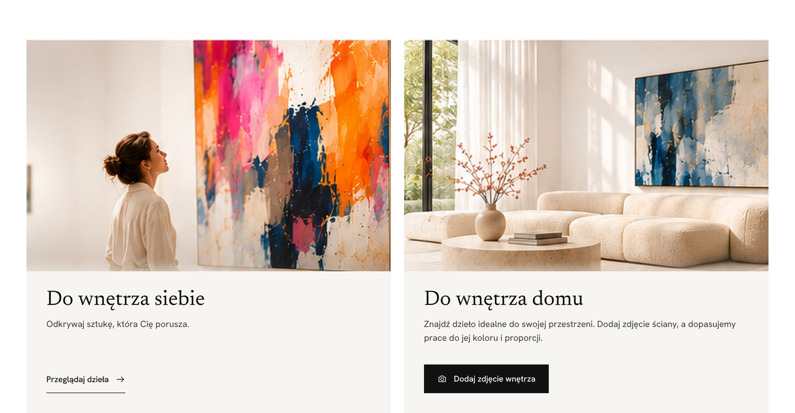 | 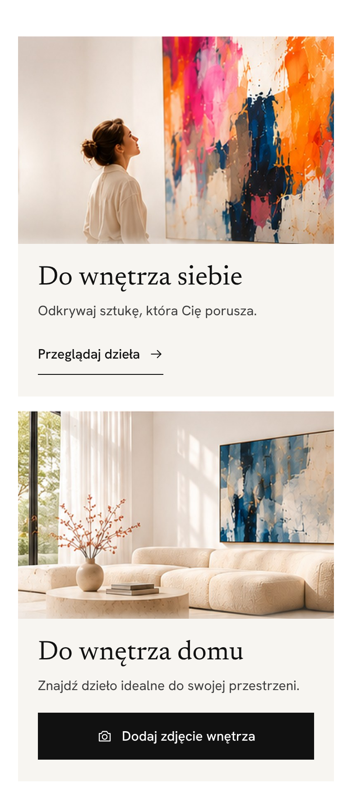 |

**Desktop:**
- `padding-top: 72px`. Dwie **równe** kolumny `1fr 1fr`, `gap: 24px`, każdy kafel 660 px szerokości.
- Kafel: tło `#F7F5F1`, zdjęcie 660×420, treść z `padding: 32px 36px 36px`.
- H2 38 px (588×42). Pod nim akapit 16 px.
- Przycisk lub link wyrównany do dołu (`flex-grow` spacer).

**Mobile:**
- Kafle jeden pod drugim, `gap: 16px`.
- Zdjęcie 350×230, treść `padding: 22px 22px 24px`, H2 30 px.

| Kafel | Tekst | Akcja |
|---|---|---|
| Do wnętrza siebie | „Odkrywaj sztukę, która Cię porusza.” | link podkreślony „Przeglądaj dzieła →” (143×49), `border-bottom: 1px solid #111` |
| Do wnętrza domu | „Znajdź dzieło idealne do swojej przestrzeni. Dodaj zdjęcie ściany, a dopasujemy prace do jej koloru i proporcji.” (mobile: tylko pierwsze zdanie) | **czarny przycisk „Dodaj zdjęcie wnętrza”** z ikoną aparatu, 226×52 desktop / 306×52 mobile. Brief wymaga, żeby to CTA było widoczne w kaflu |

Hover: zdjęcie `scale(1.04)` przez 1,1 s, strzałka przesuwa się o 5 px.

### 6.4 Korzyści (4)

| Desktop | Mobile |
|---|---|
| 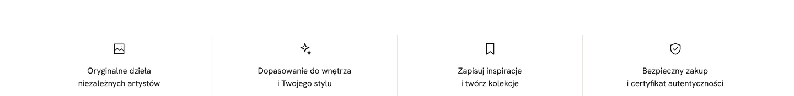 | 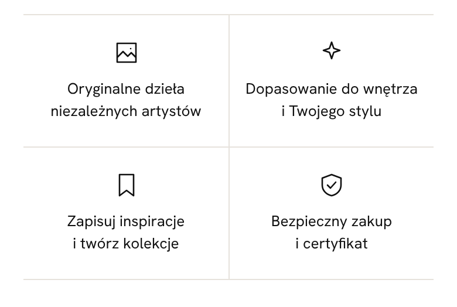 |

- **Desktop:** `padding-top: 64px`, `ul` w siatce 4 kolumn.
  - Każdy `li`: kolumna wyśrodkowana, `gap: 16px`, `padding: 12px 20px`.
  - Od drugiego elementu `border-left: 1px solid #E6E2DC`.
  - Ikona liniowa 26 px (`stroke-width: 1.3`), tekst 15 px / 1.5 w dwóch liniach.
- **Mobile:** siatka 2×2.
  - `border-top` na całej siatce, `border-bottom` na każdym polu, `border-left` na prawej kolumnie.
  - Ikona 24 px, tekst 13 px / 1.45, `padding: 20px 8px`.
- **Teksty:**
  1. Oryginalne dzieła / niezależnych artystów
  2. Dopasowanie do wnętrza / i Twojego stylu
  3. Zapisuj inspiracje / i twórz kolekcje
  4. Bezpieczny zakup / i certyfikat autentyczności (mobile: „i certyfikat”)

### 6.5 Ostatnio dodane

| Desktop | Mobile |
|---|---|
| 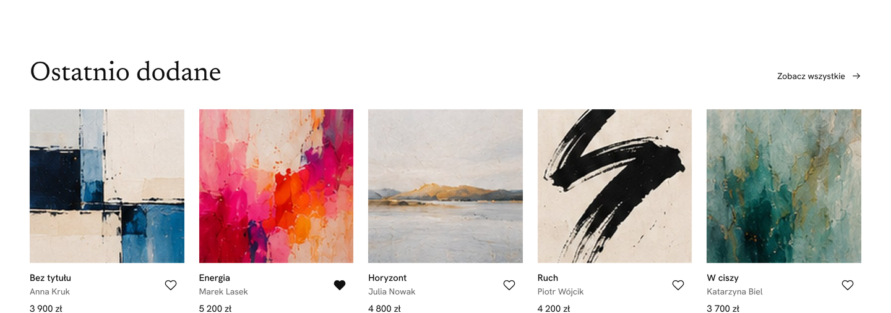 | 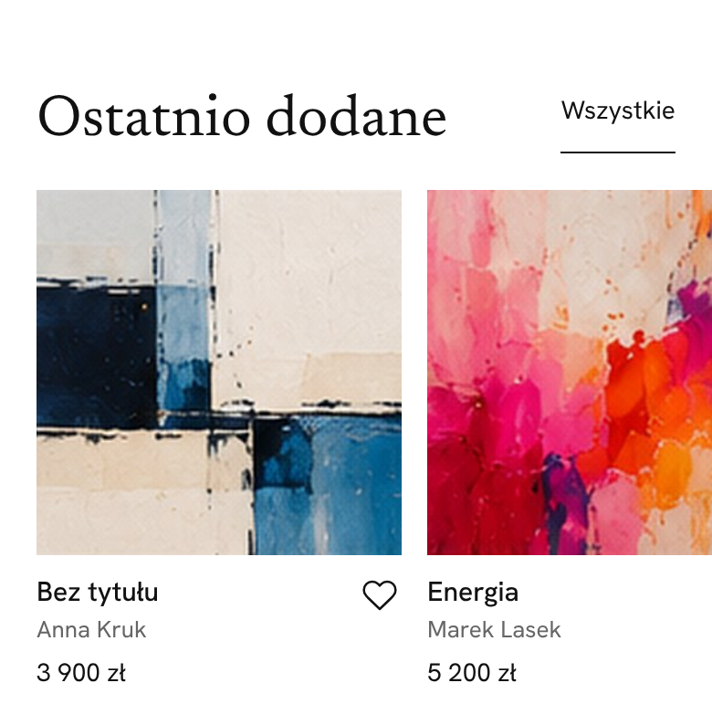 |

**Desktop:**
- `padding-top: 96px`.
- Nagłówek w jednym wierszu: H2 44 px po lewej, „Zobacz wszystkie →” 14 px (135,5×44) po prawej.
- Pod nim (`margin-top: 32px`) 5 kart w siatce: `grid-auto-flow: column; grid-auto-columns: minmax(220px,1fr); gap: 24px`. Daje to 249,5 px szerokości przy 1440.
- Siatka przewija się poziomo (`scroll-snap-type: x mandatory`), gdy kart jest więcej niż miejsca.
- Karta:
  - Zdjęcie kwadrat 1:1.
  - `gap: 14px`.
  - Tytuł 15/500, artysta 14 `#666`, cena 15 (`margin-top: 6px`).
  - Po prawej przycisk serca 44×44 (toggle, wypełnienie `#111` po zapisaniu).

**Mobile:**
- Karuzela ze snapem, `padding: 0 20px`, `scroll-padding: 0 20px`.
- Karty 200 px, zdjęcie 200×200, `gap: 14px`.
- Link „Wszystkie” podkreślony.

```astro
---
// src/components/home/ArtworkCard.astro
const { a } = Astro.props; // { slug, title, artist, price, img, alt }
---
<article class="card">
  <a href={`/dzielo/${a.slug}`} class="ph card__img" aria-label={`${a.title}, ${a.artist}`}></a>
  <div class="card__row">
    <div class="card__meta">
      <span class="card__t">{a.title}</span><span class="card__a">{a.artist}</span><span class="card__p">{a.price}</span>
    </div>
    <button class="ico save" aria-pressed="false" aria-label={`Zapisz: ${a.title}`} data-save={a.slug}><!-- serce 20 px --></button>
  </div>
</article>
<style>
  .card { scroll-snap-align: start; display: flex; flex-direction: column; gap: 14px; }
  .card__img { display: block; aspect-ratio: 1 / 1; }
  .card:hover .card__img img { transform: scale(1.04); }
  .card__row { display: flex; justify-content: space-between; gap: 8px; }
  .card__meta { display: flex; flex-direction: column; gap: 3px; }
  .card__t { font: 500 15px var(--f-ui); } .card__a { font: 400 14px var(--f-ui); color: var(--c-muted-2); }
  .card__p { font: 400 15px var(--f-ui); margin-top: 6px; }
  @media (max-width: 1023px) {
    .card { flex: 0 0 200px; gap: 10px; } .card__img { aspect-ratio: auto; height: 200px; }
    .card__a { font-size: 13px; } .card__p { font-size: 14px; margin-top: 4px; }
  }
</style>
```

Dane pobierasz z API sklepu (Medusa/Mercur): `GET /store/products?order=-created_at&limit=10` z filtrem kraju kupującego. Zasady masz w PRD (§ lokalizacja treści).

### 6.6 Inspiracje (zajawka na home)

| Desktop | Mobile |
|---|---|
| 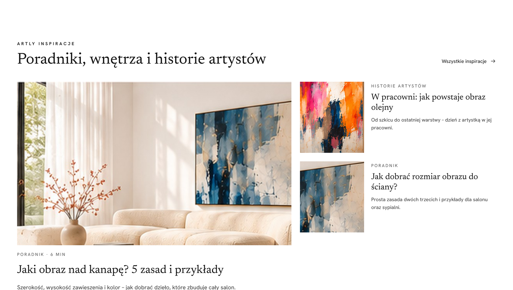 | 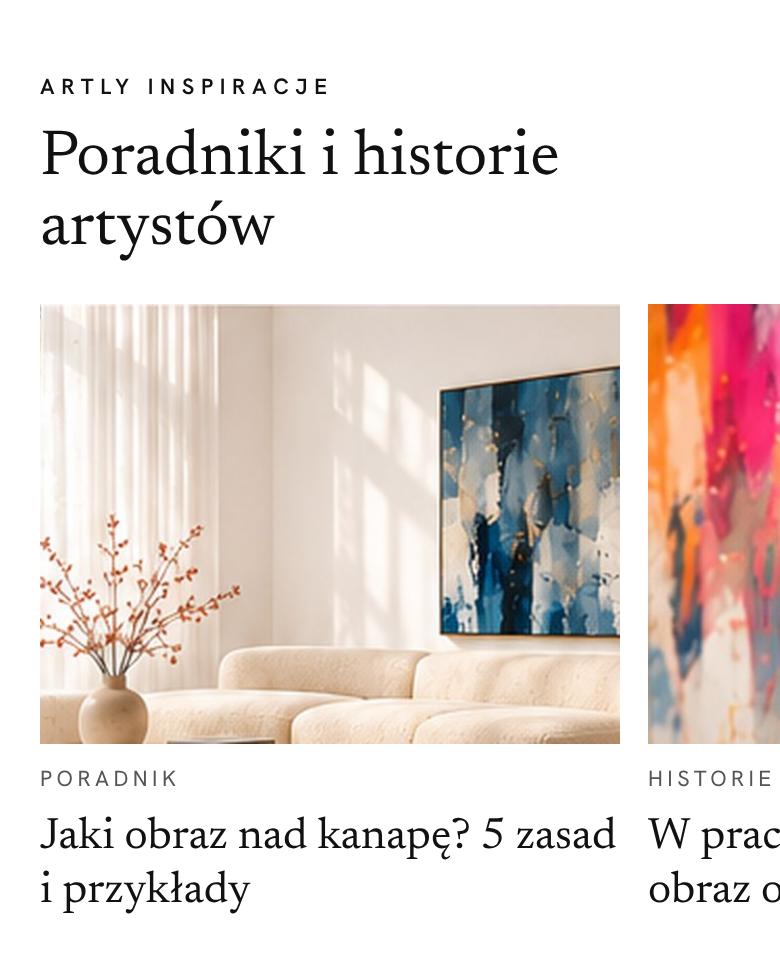 |

**Desktop:**
- `padding-top: 112px`.
- Nagłówek: eyebrow „ARTLY INSPIRACJE”, pod nim H2 44 px „Poradniki, wnętrza i historie artystów”, link „Wszystkie inspiracje →” po prawej.
- Siatka `7fr 5fr`, `gap: 24px`:
  - Po lewej artykuł wyróżniony: zdjęcie 770×460, kategoria 12 px `.2em`, tytuł Newsreader 32 px, zajawka 16 px.
  - Po prawej 2 artykuły w układzie `180px 1fr`: zdjęcie 180×200, kategoria, tytuł 24 px, zajawka 14 px.

**Mobile:**
- Karuzela kart 290 px, zdjęcie 290×220.
- Pod zdjęciem kategoria 11 px i tytuł Newsreader 22 px.

Dane pobierasz z kolekcji `inspiracje` (§9). Bierz 3 najnowsze, pierwsza to `featured: true`.

### 6.7 Dla artystów

| Desktop | Mobile |
|---|---|
| 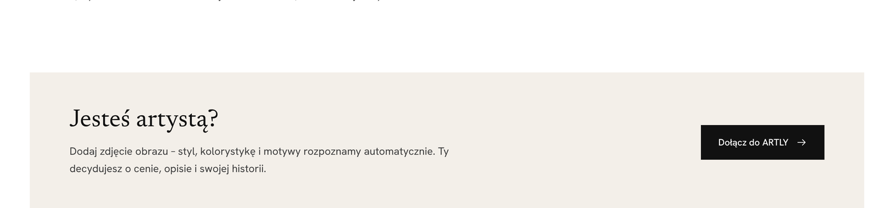 | 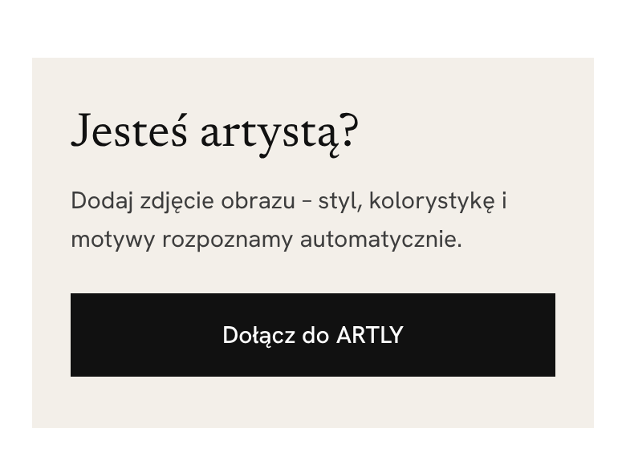 |

- **Desktop:** `padding-top: 112px`.
  - Blok `#F3EFE9`, `padding: 56px 64px`, siatka `1fr auto`.
  - H2 40 px „Jesteś artystą?” plus akapit 17 px (`max-width: 620px`).
  - Przycisk „Dołącz do ARTLY →” 199×56.
- **Mobile:** `padding: 32px 24px`, H2 30 px, przycisk na pełną szerokość 302×52.

### 6.8 Stopka

| Desktop | Mobile |
|---|---|
| 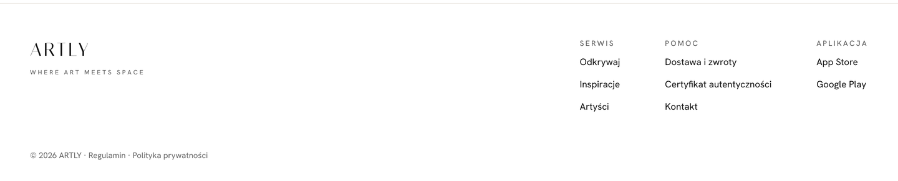 | 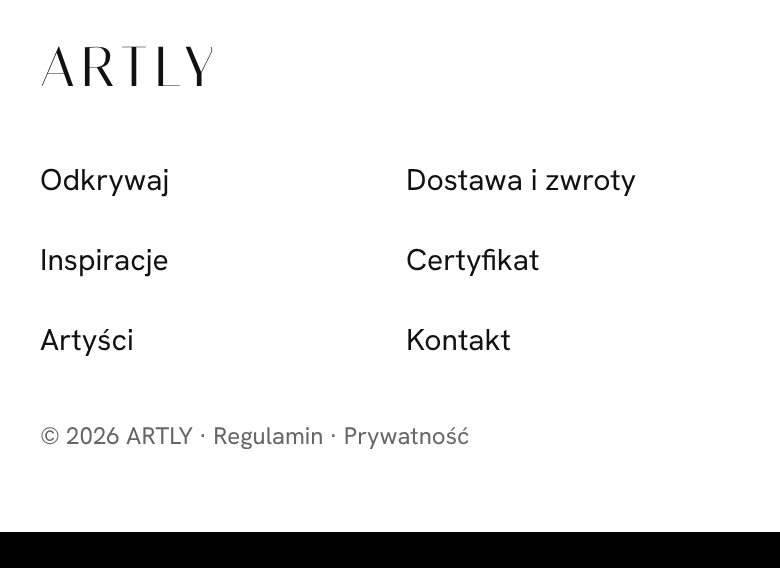 |

- **Desktop:** `margin-top: 112px`, linia `#ECE8E2`, `padding: 56px 48px 48px`.
  - Po lewej logo 30 px + tagline.
  - Po prawej 3 kolumny co 72 px: SERWIS / POMOC / APLIKACJA. Nagłówek 12 px `.2em #555`, linki 15 px, wysokość 32 px.
  - Na dole „© 2026 ARTLY · Regulamin · Polityka prywatności” 13 px `#666`.
- **Mobile:** logo 28 px, linki w siatce 2 kolumn (wysokość 40 px), copyright 12 px.

### 6.9 Pełne widoki i redline

- `screenshots/pelne/W01_desktop@1x.png`: 1440×3696, referencja desktop.
- `screenshots/pelne/W02_mobile@1x.png`: 390×3426, referencja mobile przy pierwszej wizycie (z banerem aplikacji).
- `screenshots/pelne/W02b_mobile_po_zamknieciu_banera@1x.png`: 390×3354, mobile po zamknięciu banera.
- `screenshots/pelne/W04_mobile_baner_aplikacji@1x.png`: pierwszy ekran z banerem.
- `screenshots/redline/*`: ramki z wymiarami. Kolor ramki oznacza typ elementu:
  - różowa – link lub przycisk,
  - niebieska – nagłówek,
  - zielona – zdjęcie.

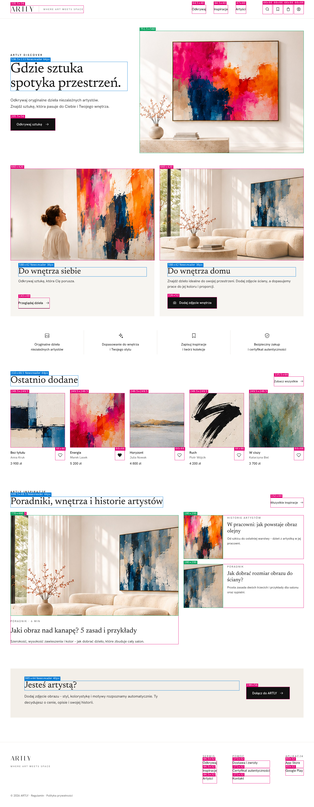

### 6.10 Zdjęcia

`assets/` zawiera zdjęcia z makiety briefu (wnętrza i obrazy). To **tymczasowe placeholdery**, w niskiej rozdzielczości, tylko do odwzorowania układu. Przed publikacją:

1. Zastąp je zdjęciami prac z katalogu ARTLY i fotografiami wnętrz z prawami do użycia.
2. Generuj obrazy przez `astro:assets` w formatach AVIF i WebP z `widths` i `sizes`.
3. Hero ładuj z `loading="eager"`, resztę lazy.
4. Placeholder w trakcie ładowania to tło `#F3EFE9`. Zachowaj wymiary kontenera, żeby nie było przeskoku (CLS = 0).

---

## 7. Krok 5 – ruch i animacje

Ruch jest subtelny, bez efektownych przejść. Wszystko wyłącza `prefers-reduced-motion: reduce`.

| Element | Animacja | Parametry |
|---|---|---|
| Hero: eyebrow → H1 → akapit → CTA | fade-up | `translateY(24px) → 0`, `opacity 0 → 1`, 0,9 s `var(--ease)`, opóźnienia 0 / 80 / 180 / 280 ms (`.d1`–`.d3`) |
| Zdjęcie hero | zoom-out | `scale(1.06) → 1`, 2,4 s |
| Sekcje i karty przy przewijaniu | fade-up | scroll-driven `animation-timeline: view(); animation-range: entry 0% entry 100%`; fallback IntersectionObserver |
| Hover zdjęć kart i kafli | zoom | `scale(1.04)`, 1,1 s |
| Hover strzałek CTA | przesunięcie | `translateX(5px)`, 0,3 s |
| Hover linków menu | podkreślenie | `scaleX(0 → 1)` od lewej, 0,35 s |
| Hover przycisku | kolor | `#111 → #2B2B2B`, 0,25 s |
| Menu mobile | wejście | fade + `translateY(-8px)`, 0,3 s |
| Przejścia między podstronami | Astro `<ClientRouter />` | domyślny crossfade 0,2 s; `transition:name` na zdjęciu dzieła (lista → karta) |

```css
/* src/styles/motion.css — ARTLY v2 */
@keyframes fadeUp { from { opacity: 0; transform: translateY(24px); } to { opacity: 1; transform: none; } }
@keyframes slowZoom { from { transform: scale(1.06); } to { transform: scale(1); } }
.in { animation: fadeUp .9s var(--ease) both; }
.d1 { animation-delay: .08s; } .d2 { animation-delay: .18s; } .d3 { animation-delay: .28s; }
.zoom { animation: slowZoom 2.4s var(--ease) both; }
@supports (animation-timeline: view()) {
  .rv { animation: fadeUp linear both; animation-timeline: view(); animation-range: entry 0% entry 100%; }
}
@media (prefers-reduced-motion: reduce) { .in, .zoom, .rv { animation: none !important; } }
```

```ts
// src/scripts/reveal.ts – fallback dla przeglądarek bez scroll-driven animations
if (!CSS.supports('animation-timeline: view()')) {
  const io = new IntersectionObserver((es) => es.forEach(e => {
    if (e.isIntersecting) { e.target.classList.add('in'); io.unobserve(e.target); }
  }), { rootMargin: '0px 0px -10% 0px' });
  document.querySelectorAll('.rv').forEach(el => io.observe(el));
}
```

> **Ważne przy pomiarze:** animacje wejścia nie mogą zostawiać elementów przesuniętych. Test uruchamia przeglądarkę z `reducedMotion: 'reduce'`, więc wszystkie elementy muszą wtedy stać w pozycji końcowej.

---

## 8. Krok 6 – breakpointy

| Zakres | Układ | Referencja |
|---|---|---|
| ≥ 1024 px | desktop: kontener 1344 + gutter 48 (przy węższych oknach treść = okno − 96) | `W01_desktop` przy 1440 |
| 1023–391 px | układ mobilny (jak 390), gutter 20; karty karuzel bez zmian, zdjęcia hero i kafli na pełną szerokość treści | brak osobnej referencji – nie może być poziomego scrolla strony |
| 390 px | układ mobilny | `W02_mobile` przy 390 |
| < 390 px (do 360) | jak 390, elementy fluid; przycisk hero i „Dodaj zdjęcie wnętrza” na pełną szerokość | brak – sprawdzić brak przepełnień |

---

## 9. Krok 7 – Inspiracje i SEO

Brief (slajdy 10, 13–16) wprowadza **nową, publiczną sekcję „Inspiracje”** w menu. To nie zmiana istniejącego Journal. Wygląd listy i karty artykułu jest w folderze aplikacji (`02_Aplikacja_Web_Mobile`, ekrany **A06 Inspiracje** i **A07 Artykuł**). Na stronie www użyj tych samych proporcji: na desktopie kontener 1344, siatka 3 kolumn, artykuł w kolumnie 720 px.

**Kolekcja treści** `src/content.config.ts`:

```ts
import { defineCollection, z } from 'astro:content';
import { glob } from 'astro/loaders';
export const collections = {
  inspiracje: defineCollection({
    loader: glob({ pattern: '**/*.md', base: './src/content/inspiracje' }),
    schema: ({ image }) => z.object({
      title: z.string(),                 // H1 (jeden na stronę)
      seoTitle: z.string().max(60),      // <title>
      description: z.string().max(160),  // meta description
      lead: z.string(),                  // zajawka
      author: z.string(),
      date: z.coerce.date(),
      category: z.enum(['Poradniki', 'Wnętrza i projekty', 'Historie artystów', 'Trendy']),
      cover: image(), coverAlt: z.string(),
      featured: z.boolean().default(false),
      artworks: z.array(z.string()).default([]), // slugi dzieł → blok „Obrazy pasujące do tej inspiracji”
      draft: z.boolean().default(false),
    }),
  }),
};
```

**Adresy:** `/inspiracje/` i `/inspiracje/<slug>/`, np. `/inspiracje/jaki-obraz-nad-kanape/`, `/inspiracje/jak-dobrac-rozmiar-obrazu/`.

**Wymogi SEO z briefu:**
1. Jeden H1, śródtytuły H2/H3.
2. Edytowalny `title` i `description`.
3. Czytelny URL.
4. `alt` dla każdego zdjęcia.
5. Linki do kategorii, dzieł i artystów.
6. Bloki „Zobacz podobne obrazy” i „Czytaj dalej”.
7. Treść renderowana statycznie i indeksowalna (Astro SSG).
8. `Article` JSON-LD i `BreadcrumbList`.

**Edycja bez programisty (brief, slajd 13):**
- Podepnij headless CMS do tej kolekcji (Decap/Keystatic/Sanity).
- Pola jak w schemacie, wersja robocza (`draft`) i podgląd.
- Wybór dzieł z katalogu zapisywany jako slugi.

---

## 9a. SEO całej witryny (obowiązkowe)

Wymogi z briefu dla Inspiracji są w §9. Poniższe dotyczą **każdej strony ARTLY**.

**Techniczne:**
1. **Renderowanie.** Wszystkie strony publiczne, czyli home, lista i karta dzieła, artyści, profil artysty, Inspiracje i pomoc, są generowane statycznie lub SSR w Astro. Treść jest w HTML bez JavaScriptu. Karty dzieł odświeżaj przez ISR/rebuild po zmianie w katalogu (webhook z Medusa).
2. **Adresy:**
   - dzieło: `/dzielo/<tytul>-<artysta>-<id>/`,
   - artysta: `/artysta/<imie-nazwisko>/`,
   - Inspiracje: `/inspiracje/<slug>/`,
   - styl i kategoria: `/odkrywaj/<styl>/`, np. `/odkrywaj/abstrakcja/`.

   Adresy z małych liter, bez polskich znaków, z ukośnikiem na końcu. 301 ze starych adresów (`/journal/…`, jeśli istnieją; patrz brief, pytanie 6).
3. **`<head>` każdej strony:**
   - unikalny `title` (≤ 60 znaków) i `meta description` (≤ 160),
   - `link rel="canonical"`,
   - Open Graph i Twitter Card: obraz 1200×630; dla dzieła zdjęcie pracy, dla pozostałych stron domyślnie biała grafika z symbolem ARTLY,
   - `theme-color #FFFFFF`,
   - favicony z `public/`: `favicon.svg`, `favicon.ico`, `apple-touch-icon-180.png`,
   - `site.webmanifest` z ikonami 192/512 z `03_Symbol_ARTLY`.
4. **Wielojęzyczność.** `hreflang` dla wszystkich wersji językowych + `x-default`, zgodnie z i18n z v1 (`/pl/`, `/en/`, `/de/` …). Język strony w `<html lang>`.
5. **Dane strukturalne (JSON-LD):**

   | Strona | Typy |
   |---|---|
   | Home | `Organization` (logo = symbol), `WebSite` z `SearchAction` |
   | Karta dzieła | `Product` + `VisualArtwork`: `artist`, `artMedium`, `width`/`height`, `offers` (cena, waluta, dostępność), `aggregateRating` **tylko z prawdziwych opinii po zakupie** |
   | Profil artysty | `Person` |
   | Inspiracje | `Article` |
   | Wszystkie | `BreadcrumbList` |
6. **Indeksowanie:**
   - `sitemap-index.xml` (`@astrojs/sitemap`) z podziałem: dzieła, artyści, inspiracje, strony.
   - `robots.txt` z adresem sitemapy.
   - **`noindex`** dla: prywatnych linków kolekcji i projektów (`/k/…`, `/p/…`), koszyka, checkout, konta, wyników wyszukiwania z parametrami oraz kombinacji filtrów inna niż pojedynczy styl lub kolor.
   - Dzieła sprzedane: strona zostaje z oznaczeniem „Sprzedane” i blokiem „Podobne dzieła”, bez 404.
7. **Szybkość (Core Web Vitals):**
   - LCP < 2,5 s: obraz hero z `fetchpriority="high"`, AVIF/WebP, `preconnect` do CDN zdjęć.
   - CLS < 0,05: stałe wymiary zdjęć, baner aplikacji bez przeskoku (§6.0).
   - INP < 200 ms.
   - Fonty z `font-display: swap` i preload Newsreader 400.
8. **Dostępność wspiera SEO.** `alt` dla każdego zdjęcia dzieła w formacie „<tytuł>, <technika>, <artysta>”, kolejność nagłówków bez przeskoków, linki z opisowym tekstem (nie „kliknij tutaj”).
9. **Baner aplikacji** zgodny z wytycznymi Google (§6.0 pkt 6). W iOS Safari natywny `apple-itunes-app`.

**Treści:**
- Każda strona stylu lub kategorii (`/odkrywaj/abstrakcja/`) ma H1 i 80–150 słów wstępu edytowalnego w CMS nad siatką dzieł.
- Profil artysty: biografia (historia z rejestracji artysty), lokalizacja, linki do dzieł.
- Inspiracje: wg planu treści z briefu (slajd 16), każdy tekst linkuje do 3–6 dzieł i 1–2 kategorii.
- Linkowanie wewnętrzne: dzieło ↔ artysta ↔ styl ↔ artykuły, które je przywołują.

**Pomiar:**
- Google Search Console (domena + sitemap), Bing Webmaster.
- GA4 / PostHog: zdarzenia `view_item`, `add_to_wishlist` (zapis do kolekcji), `begin_checkout`, `purchase`, `app_banner_*`.

## 10. Weryfikacja ±2 px

**Definicja zgodności.** Strona jest zgodna, gdy przy viewport **1440×900** i **390×844**, w Chromium, `deviceScaleFactor: 1`, `prefers-reduced-motion: reduce`, z załadowanymi fontami:

1. Każdy element kluczowy z `spec/W01_desktop.json`, `spec/W02_mobile.json` (pierwsza wizyta – pusty `localStorage`, UA telefonu z Androidem), `spec/W02b_mobile_po_zamknieciu_banera.json` i `spec/W04_mobile_baner_aplikacji.json` (`"key": true`, niezasłonięty, na ekranie) istnieje w DOM z `data-testid` równym `id` bez prefiksu ekranu.
2. Jego `x`, `y`, `w` i `h` (względem `<body data-testid="screen-root">`, czyli lewego górnego rogu strony) różnią się od spec o **nie więcej niż 2 px**.
3. `font-size`, `font-weight` i `color` tekstu są **identyczne** jak w spec.
4. Diff pikselowy z referencją `@1x` dopuszcza przesunięcie do 2 px. Zdjęcia są maskowane. Wynik nie może przekroczyć **0,3 %** pikseli.

**Uruchomienie:**

```bash
npm i -D playwright pngjs pixelmatch
npx playwright install chromium
npm run build && npm run preview   # http://localhost:4321

node tools/compare-web.mjs --spec spec/W01_desktop.json --ref screenshots/pelne/W01_desktop@1x.png \
     --url http://localhost:4321/ --root screen-root --out raport/
node tools/compare-web.mjs --spec spec/W02_mobile.json --ref screenshots/pelne/W02_mobile@1x.png \
     --url http://localhost:4321/ --root screen-root --out raport/ \
     --mobile                                   # UA Androida + dotyk – inaczej baner się nie pokaże
node tools/compare-web.mjs --spec spec/W02b_mobile_po_zamknieciu_banera.json \
     --ref screenshots/pelne/W02b_mobile_po_zamknieciu_banera@1x.png --url http://localhost:4321/ --mobile \
     --click "Zamknij baner aplikacji" --out raport/
node tools/compare-web.mjs --spec spec/W03_mobile_menu.json --ref screenshots/pelne/W03_mobile_menu@1x.png \
     --url http://localhost:4321/ --mobile --click "Zamknij baner aplikacji" --click "Menu" --out raport/
```

**Raport** (`raport/*_raport.json`):

| Wpis | Znaczenie |
|---|---|
| `MISSING` | brak elementu z danym `data-testid` |
| `FAIL` | pozycja lub rozmiar poza tolerancją, z polami `dx/dy/dw/dh` |
| `FONT` | niezgodny font |
| `*_diff.png` | czerwone piksele = różnice większe niż 2 px |

Test kończy się kodem 0 tylko przy zgodności. Podepnij go do CI (GitHub Actions) jako warunek merge'a.

**Przykład wyniku negatywnego i poprawki:**

```
{"id":"h1.gdzie-sztuka-spotyka-przestrzen","status":"FAIL","expected":{"x":48,"y":283.5,"w":536.5,"h":133},"got":{"x":48,"y":291,"w":536.5,"h":133},"dx":0,"dy":7.5,"dw":0,"dh":0}
```

→ H1 jest 7,5 px za nisko. Typowe przyczyny: eyebrow ma domyślne `line-height` zamiast wartości z tokenów albo przeglądarka dodała `margin` do `h1`. Ustaw `margin: 24px 0 0` i `line-height` zgodnie z §3.

---

## 11. Checklista odbioru

- [ ] `tokens.css` v2; w kodzie nie ma `#D2885A`, `#9E522A`, `#F7F4EF`, `#1B2530` ani żadnego `gradient(`.
- [ ] Przyciski i karty mają `border-radius: 0`; brak cieni i ozdobnych ramek.
- [ ] Menu: Odkrywaj · Inspiracje · Artyści + 4 ikony (desktop); hamburger z menu pełnoekranowym (mobile).
- [ ] Hero: „ARTLY DISCOVER”, H1 „Gdzie sztuka spotyka przestrzeń.”, **jedno** CTA „Odkrywaj sztukę”; zdjęcie nie wychodzi poza kontener.
- [ ] Dwa równe kafle; w „Do wnętrza domu” czarny przycisk „Dodaj zdjęcie wnętrza”.
- [ ] Korzyści (4) → Ostatnio dodane → Inspiracje → Dla artystów → stopka; **brak** kolekcji kuratorskich na home.
- [ ] Sekcja `/inspiracje` z kategoriami, artykułami, blokiem dzieł i SEO wg §9.
- [ ] Animacje wg §7; przy `prefers-reduced-motion` brak animacji.
- [ ] Baner aplikacji (§6.0): tylko telefony; iOS Safari – natywny banner; zamknięcie na 30 dni; `/app` przekierowuje do właściwego sklepu; CLS = 0.
- [ ] SEO wg §9 i §9a: canonical, OG, hreflang, JSON-LD, sitemapa, `noindex` dla prywatnych linków, CWV w normie.
- [ ] Favicony i OG z nowym symbolem (`public/`, `03_Symbol_ARTLY`).
- [ ] Podstrony bez projektu zbudowane wg zasad „STYL v2 = REFERENCJA” (na początku dokumentu).
- [ ] `compare-web.mjs` przechodzi dla `W01_desktop`, `W02_mobile`, `W02b_…`, `W04_…` (±2 px).
- [ ] Lighthouse: Performance ≥ 90, Accessibility ≥ 95, CLS < 0,05; brak poziomego scrolla od 360 px do 1920 px.
- [ ] Zdjęcia-placeholdery z `assets/` zastąpione realnymi przed publikacją.
