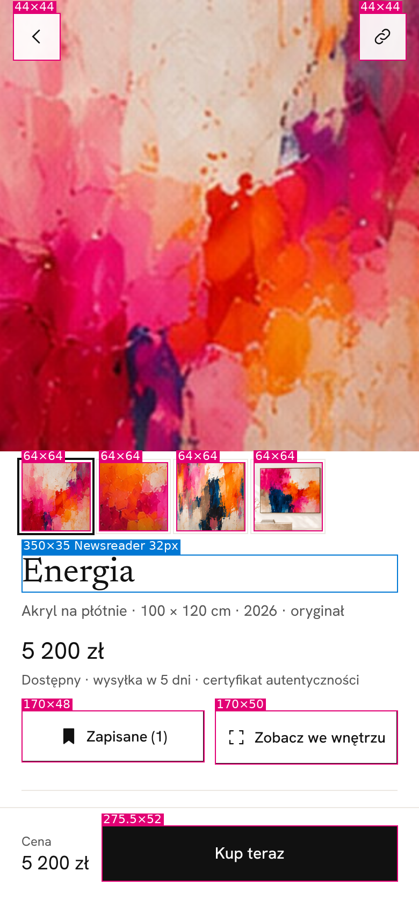

# ARTLY — aplikacja mobile (iOS/Android) i web: instrukcja wdrożenia wyglądu v2

**Wersja:** 2.0 · listopad 2026
**Stack:** React Native + Expo (iOS, Android), wersja web z tego samego kodu przez `react-native-web` (Expo web). Backend: Medusa v2 + Mercur, bez zmian względem PRD v1.1.
**Podstawa:** brief „ARTLY – zmiany do wdrożenia” (M. Dańko) oraz canvas ARTLY (artboardy 01–14 i A1–A7).
**Zastępuje:** rozdziały PRD v1.1 o wyglądzie (kolory, typografia, komponenty, ekrany kupującego). Logika biznesowa, API, panel admina, i18n i lokalizacja treści z PRD obowiązują dalej.

---

## WYMÓG NADRZĘDNY: zgodność z referencją z dokładnością do 2 px

Każdy ekran z tego folderu ma być odwzorowany tak, żeby w warunkach pomiaru z §8 spełnić wszystkie poniższe:

1. **Pozycja i rozmiar.** Każdy element oznaczony w `spec/<ekran>.json` jako `"key": true` ma `x`, `y`, `w`, `h` różne od referencji o **≤ 2 pt** (1 pt = 1 px referencji `@1x`).
2. **Typografia.** Krój, rozmiar, grubość i kolor tekstu są **identyczne** jak w spec. Tolerancja 2 pt dotyczy tylko położenia i wysokości wiersza.
3. **Kolory.** Tła, linie i tekst mają dokładnie wartości z tokenów (§3), bez zaokrąglania do „podobnych”.
4. **Diff pikselowy.** Po zamaskowaniu zdjęć różnice większe niż 2 px obejmują ≤ **0,3 %** pikseli na web i ≤ **1 %** natywnie (inny silnik renderuje tekst).
5. **Wszystkie stany.** To samo dotyczy stanów pokazanych w referencji: arkusze, menu, zakładki, edycja.

Ekran, który nie spełnia któregokolwiek punktu, **nie jest odebrany**. Wynik testu (§8) dołączasz do każdego PR z UI.

---

## ⚑ STYL v2 = REFERENCJA DLA WSZYSTKICH EKRANÓW (także tych, których nie ma w projekcie)

Referencje z tego folderu wyznaczają **styl całej aplikacji na iOS, Androidzie i w web**. Ekrany, których nie zaprojektowano, budujesz z tych samych tokenów i komponentów tak, żeby wyglądały jak część projektu. Dotyczy to m.in.:
- logowania, rejestracji i resetu hasła,
- onboardingu i zgód (powiadomienia, aparat),
- wyszukiwarki z wynikami i pełnego ekranu filtrów,
- profilu artysty oglądanego przez kupującego,
- listy wszystkich dzieł w kategorii,
- checkoutu, potwierdzenia zamówienia, historii i szczegółów zamówienia,
- wystawiania opinii po zakupie,
- ustawień, języka i usuwania konta,
- powiadomień, czatu z artystą, stanów pustych, błędów i braku sieci,
- ekranu aktualizacji, panelu architekta Pro i maili push.

Zasady:

1. **Tylko tokeny z `theme.ts` (§3).** Żadnych nowych kolorów, fontów ani promieni. `radius 0` dla przycisków, kart, pól i zdjęć. Wyjątki: przełącznik, awatar, kropki kolorów, ikona aplikacji. Bez gradientów, cieni i kolorów akcentu, bo kolor dają dzieła.
2. **Tylko komponenty z §4.** Nowy wariant komponentu wymaga akceptacji projektanta.
3. **Wzory układów:**

   | Typ ekranu | Wzór |
   |---|---|
   | Lista | A02 / A04: siatka 2 kolumny 170 + 14 lub wiersze 72–84 z linią `#ECE8E2` |
   | Szczegóły | A03: zdjęcie na pełną szerokość, H1 32, meta 14 `#555`, stały dolny pasek akcji 84 |
   | Formularz | A04 „Nowa kolekcja”: etykieta 13 `#555`, pole 48, odstęp 14, przycisk główny 52 na pełną szerokość u dołu |
   | Tekst | A07: H1 32, akapity 16 / 1,65, H2 24 |
   | Ustawienia | A09: wiersze 56 z ikoną 20, etykietą 15 i wartością 13 `#555` |
   | Stan pusty / błąd | tytuł Newsreader 24 + jedno zdanie 15 `#555` + jeden przycisk główny; bez ilustracji |
   | Potwierdzenia | toast (§4); arkusz tylko gdy potrzebna decyzja |

4. **Siatka:**
   - margines 20, nagłówek sekcji Newsreader 24–26 z linkiem „Wszystkie” po prawej,
   - odstępy między sekcjami 28–36, w ramach sekcji 10–18,
   - górny pasek 56 z przyciskiem „wstecz” 44×44,
   - pasek zakładek zawsze widoczny na ekranach głównych, ukryty w checkout i na pełnoekranowych podglądach.
5. **Ruch.** Arkusz 350 ms, toast 2,4 s, fade-up 400 ms dla nowych elementów list. Bez innych efektów.
6. **Zgodność.** Ekrany bez referencji nie podlegają testowi ±2 px jako całość. Wspólne komponenty na nich (pasek zakładek, przyciski, karty, arkusze, pola) muszą mieć **dokładnie** wymiary z referencji (±2 pt). Po zaprojektowaniu takiego ekranu dochodzi on do testów jak pozostałe.
7. **Wątpliwości.** Gdy rozwiązanie nie wynika z tych zasad, zapytaj projektanta przed implementacją.

---

## Spis treści

1. [Zawartość folderu](#1-zawartość-folderu)
2. [Jak czytać referencję](#2-jak-czytać-referencję)
3. [Tokeny – `theme.ts`](#3-tokeny--themets)
4. [Komponenty wspólne (z wymiarami)](#4-komponenty-wspólne)
5. [Ekrany – lista, stany, nawigacja](#5-ekrany)
6. [Mobile vs web – różnice platform](#6-mobile-vs-web)
   - [6a. Symbol, ikona aplikacji, splash](#6a-symbol-ikona-aplikacji-splash)
   - [6b. Web na telefonie: baner pobierania aplikacji](#6b-web-na-telefonie-baner-pobierania-aplikacji)
   - [6c. SEO aplikacji web](#6c-seo-aplikacji-web)
7. [Przykłady instrukcji (zadania dla zespołu / agenta AI)](#7-przykłady-instrukcji)
8. [Weryfikacja ±2 px – procedura i narzędzia](#8-weryfikacja-2-px)
9. [Checklista odbioru](#9-checklista-odbioru)

---

## 1. Zawartość folderu

```
02_Aplikacja_Web_Mobile/
├── INSTRUKCJA_Aplikacja_Web_Mobile.md     ← ten plik
├── reference_1x/   <ekran>@1x.png   – REFERENCJA do pomiaru (390 pt szer.; 1 px = 1 pt)
├── preview_2x/     <ekran>@2x.png   – podgląd w wysokiej rozdzielczości
├── redline/        <ekran>_redline.png – ramki i wymiary elementów kluczowych
├── spec/           <ekran>.json     – pozycje, rozmiary, fonty, kolory wszystkich elementów
├── assets/         zdjęcia przykładowe (placeholdery – do zastąpienia katalogiem)
├── app-icon/       ikona iOS/Android i symbol do splash (nowy symbol ARTLY)
└── tools/          compare-lib.mjs, compare-web.mjs, compare-png.mjs, layout.e2e.ts
```

**Legenda redline:**
- różowa ramka – element interaktywny (przycisk, link, pole),
- niebieska – nagłówek (z krojem i rozmiarem),
- zielona – kontener zdjęcia.
- Etykieta podaje `szerokość×wysokość` w pt.



---

## 2. Jak czytać referencję

- **Szerokość bazowa: 390 pt** (iPhone 12/13/14). Wysokość widoku: 844 pt.
- **Y = 0 to górna krawędź safe area**, pod status barem. Referencje nie zawierają status bara.
- **Dolny pasek zakładek ma 76 pt** w referencji. Na urządzeniach ze wskaźnikiem Home: 60 pt treści + `max(16, insets.bottom)` (§6).
- Ekrany z wewnętrznym przewijaniem mają dwie wersje:
  - `<ekran>.png` – pierwszy widok 844 pt,
  - `<ekran>_pelny.png` – cała treść rozwinięta.
- Ekrany długie (A02 Odkrywaj 2710 pt, A09 Konto 1580 pt, B04 1790 pt) są pokazane w całości. Pasek zakładek jest na nich `sticky` i w aplikacji zawsze siedzi u dołu ekranu.
- **Format `spec/<ekran>.json`:**

```json
{
  "screen": "A01_start",
  "viewport": { "w": 390, "h": 844 },
  "elements": [
    { "id": "A01_start.a.odkrywaj-sztuke", "key": true, "tag": "a", "text": "Odkrywaj sztukę",
      "x": 20, "y": 712, "w": 350, "h": 54,
      "font": { "family": "Hanken Grotesk", "size": "15px", "weight": "500", "lineHeight": "normal", "letterSpacing": "normal", "color": "rgb(255, 255, 255)" },
      "bg": "rgb(17, 17, 17)" }
  ]
}
```

- **testID:** każdy element `"key": true` musi mieć w kodzie `testID` równy `id` **bez prefiksu ekranu**. Przykład: `testID="a.odkrywaj-sztuke"`. Na web `react-native-web` zamienia go na `data-testid`. Ekran ma `testID="screen-root"` na kontenerze safe area.
  - Wartości `id` generuje się z typu i tekstu elementu: `a`/`button` = akcja, `h1`/`h2` = nagłówek, `img` = kontener zdjęcia, `input` = pole.
  - Przy powtórzeniach dodawany jest sufiks `-2`, `-3`.
- `"covered": true` = element w referencji przykryty, np. arkuszem albo paskiem. Test go pomija.
- `"offscreen": true` = poza ekranem, np. dalsze karty karuzeli. Też pomijany.

---

## 3. Tokeny – `theme.ts`

```ts
// src/theme.ts — ARTLY v2 (jedyne źródło kolorów, fontów i wymiarów)
export const color = {
  bg: '#FFFFFF',
  ink: '#111111',        // tekst główny, przyciski, ikony aktywne
  text2: '#333333',      // akapity
  text3: '#2B2B2B',      // treść artykułu
  muted: '#555555',      // etykiety, opisy
  muted2: '#666666',     // nazwiska artystów, nieaktywne zakładki
  beige: '#F3EFE9',      // placeholder zdjęć, banery
  beige2: '#F7F5F1',     // panele informacyjne, tło kafli
  line: '#ECE8E2',       // separatory list, pasek zakładek
  line2: '#E6E2DC',
  field: '#DAD5CD',      // obramowanie pól, chipów nieaktywnych
  dash: '#AFA9A0',       // obramowanie przerywane „Dodaj”
  switchOff: '#D6D1C9',
  overlay: 'rgba(17,17,17,0.38)', // tło pod arkuszem
  onInk: '#FFFFFF',
} as const;

export const font = {
  logo: 'Italiana_400Regular',
  display: 'Newsreader_400Regular',
  displayItalic: 'Newsreader_400Regular_Italic',
  ui: 'HankenGrotesk_400Regular',
  uiMedium: 'HankenGrotesk_500Medium',
  uiSemi: 'HankenGrotesk_600SemiBold',
} as const;
// Ładowanie: @expo-google-fonts/italiana, /newsreader, /hanken-grotesk (useFonts przed SplashScreen.hideAsync).
// Na Androidzie zawsze: includeFontPadding: false, textAlignVertical: 'center'.

// Wysokość wiersza „normal” w referencji (Chromium) dla Hanken Grotesk ≈ round(size × 1,3).
// W RN ustawiaj lineHeight jawnie – inaczej iOS/Android dadzą inną wysokość i przekroczysz 2 pt.
const lh = (s: number) => Math.round(s * 1.3);

export const type = {
  logo28:   { fontFamily: font.logo, fontSize: 28, lineHeight: 28, letterSpacing: 3.36 },   // .12em
  logo26:   { fontFamily: font.logo, fontSize: 26, lineHeight: 26, letterSpacing: 3.12 },
  h1_34:    { fontFamily: font.display, fontSize: 34, lineHeight: 36 },   // Start
  h1_32:    { fontFamily: font.display, fontSize: 32, lineHeight: 35 },   // Dzieło, Kolekcja, Projekt, Artykuł
  h2_26:    { fontFamily: font.display, fontSize: 26, lineHeight: 29 },   // sekcje Odkrywaj, arkusze
  h2_24:    { fontFamily: font.display, fontSize: 24, lineHeight: 29 },
  h3_22:    { fontFamily: font.display, fontSize: 22, lineHeight: 26 },
  title19:  { fontFamily: font.display, fontSize: 19, lineHeight: 22 },   // kafle na Start
  title18:  { fontFamily: font.display, fontSize: 18, lineHeight: 22 },   // tytuły artykułów w listach
  eyebrow:  { fontFamily: font.uiSemi, fontSize: 11, lineHeight: lh(11), letterSpacing: 3.08 }, // .28–.3em, WERSALIKI
  label11:  { fontFamily: font.ui, fontSize: 11, lineHeight: lh(11), letterSpacing: 1.98 },     // kategorie (.18em)
  body16:   { fontFamily: font.ui, fontSize: 16, lineHeight: lh(16) },
  body15:   { fontFamily: font.ui, fontSize: 15, lineHeight: 23 },        // akapity 1,55
  ui15m:    { fontFamily: font.uiMedium, fontSize: 15, lineHeight: lh(15) }, // przyciski główne
  ui15s:    { fontFamily: font.uiSemi, fontSize: 15, lineHeight: lh(15) },
  ui14:     { fontFamily: font.ui, fontSize: 14, lineHeight: lh(14) },
  ui14m:    { fontFamily: font.uiMedium, fontSize: 14, lineHeight: lh(14) },
  ui13:     { fontFamily: font.ui, fontSize: 13, lineHeight: lh(13) },
  ui12:     { fontFamily: font.ui, fontSize: 12, lineHeight: lh(12) },
  tab11:    { fontFamily: font.ui, fontSize: 11, lineHeight: lh(11) },   // aktywna: uiSemi
} as const;

export const size = {
  gutter: 20,          // margines poziomy ekranów
  tabBar: 76,          // w referencji (60 + 16)
  topBar: 56,          // pasek z „wstecz” na ekranach szczegółów (Odkrywaj: 60)
  touch: 44,           // minimalny cel dotyku
  btnL: 54, btnM: 52, btnS: 48, btnXS: 44, btnChip: 40,
  radius: 0,           // przyciski, karty, zdjęcia, pola – ZAWSZE 0
  radiusPill: 999,     // tylko: przełącznik, awatar, kropki kolorów
} as const;

export const motion = {
  sheetIn: { duration: 350, easing: [0.2, 0.8, 0.2, 1] },   // translateY 100% → 0
  overlayIn: { duration: 250 },
  toast: { duration: 2400 },                                // wejście 12 %, wyjście od 85 %
  fadeUp: { duration: 400, distance: 8 },                   // wiersze list, siatki po filtrze
  imageSwap: { duration: 400 },                             // galeria dzieła: opacity .3 → 1
  startZoom: { duration: 2400, from: 1.08 },                // zdjęcie na Start
};
```

> Długości w spec są w pt (px CSS). `letter-spacing` w em przeliczasz na RN: `em × fontSize`, np. 0,3 em × 11 = 3,3. W web zostaw em.

---

## 4. Komponenty wspólne

Wszystkie wymiary w pt. Gdy wymiar w spec ekranu różni się od wartości tutaj, wygrywa spec.

| Komponent | Wygląd i wymiary | Stany / zachowanie |
|---|---|---|
| **TabBar** | wys. 76 (pad 6/8/16), tło `#FFF`, górna linia 1 `#ECE8E2`; 4 równe kolumny; ikona 22 (stroke 1,5, aktywna 1,8), odstęp 4, etykieta 11 | aktywna: `#111` + 600, `aria-current`; nieaktywna `#666` 400. Kolejność: **Odkrywaj** (lupa) · **Dopasuj** (narożniki kadru) · **Zapisane** (zakładka) · **Konto** (osoba w kole) |
| **Przycisk główny** | tło `#111`, tekst `#FFF` Hanken 500 15, wys. 54 (Start), 52 (dolne paski, arkusze), szer. wg spec; `radius 0` | wciśnięty: `#2B2B2B`; z ikoną: ikona 18, odstęp 8–12 |
| **Przycisk obrysowy** | 1 px `#111`, tło `#FFF`, tekst 14–15 / 500, wys. 48 | wciśnięty: tło `#F3EFE9` |
| **Ikona-przycisk** | 44×44, ikona 20 (stroke 1,5–1,6); na zdjęciu tło `rgba(255,255,255,.92)` | – |
| **Chip filtra** | wys. 40, pad 0 14, obrys 1 `#DAD5CD`, tekst 13–14 | wybrany: tło i obrys `#111`, tekst `#FFF`; z kropką koloru 14 pt |
| **Kafelek stylu** (Odkrywaj) | obraz 96×96, podpis 13 (wybrany 600) | wybrany: `outline 2 #111`, odsunięcie 2 |
| **Pole tekstowe** | wys. 48, pad 0 14, obrys 1 `#DAD5CD`, tekst 15; etykieta 13 `#555` nad polem (odstęp 6) | focus: obrys `#111` |
| **Wyszukiwarka** | wys. 48, ikona lupy 18, placeholder 15 „Szukaj: artysta, styl, motyw” | – |
| **ArtworkCard – rail** | zdjęcie 150×150, tytuł 14/500, artysta 12 `#666`, cena 13 (mt 3), odstęp 8 | dotknięcie → A03 |
| **ArtworkCard – siatka 2 kol.** | kolumny 170 + 14 odstępu, zdjęcie 170 wys., serce 18 w polu 44 (offset −10/−12) | serce: toggle zapisu, wypełnienie `#111` |
| **ArtworkRow – lista** | zdjęcie 72 lub 84, tytuł 14–15/500, meta 12, linia 1 `#ECE8E2` | w Kolekcji: tryb edycji ze strzałkami 32×32 i koszem 44 |
| **Karta kuratorska** | 280 szer., zdjęcie 190, tytuł Newsreader 21, meta 12 `#555` | – |
| **BottomSheet** | od dołu, tło `#FFF`, pad 12/20/28, uchwyt 40×4 `#DAD5CD` (mb 16); overlay `rgba(17,17,17,.38)` | wejście 350 ms; tap w overlay zamyka; **nad TabBarem** (zIndex wyższy) |
| **Toast** | tło `#111`, tekst 14 `#FFF`, pad 12/16, wyśrodkowany, 16 pt nad dolnym paskiem | 2,4 s; `accessibilityLiveRegion="polite"` |
| **Switch** | 48×28 (Kolekcja) / 40×24 (Projekt), gałka 22/18, on `#111`, off `#D6D1C9` | animacja 200 ms |
| **Checkbox** | 24×24 (arkusz) / 22×22, obrys 1 `#111`, zaznaczony: tło `#111` + ✓ biały | – |
| **Panel informacyjny** | tło `#F7F5F1`, pad 12, ikona kłódki 16, tekst 13 / 1,45 | – |
| **Placeholder zdjęcia** | tło `#F3EFE9`, `resizeMode="cover"` | ładowanie: zostaje tło, bez spinnera |

Ikony to liniowe SVG (`react-native-svg`), stroke = kolor tekstu. Ścieżki ikon skopiuj z plików `.dc.html` w canvasie. Nie używaj emoji ani ikon wypełnionych, poza sercem i zakładką w stanie zapisanym.

---

## 5. Ekrany

Kolumna „Pliki” odnosi się do `reference_1x/`, `preview_2x/`, `redline/` i `spec/` o tej samej nazwie.

### 5.1 Ścieżka kupującego

| Ekran | Pliki (stany) | Co zawiera | Nawigacja i interakcje |
|---|---|---|---|
| **A01 Start** | `A01_start` | header ARTLY + tagline, zdjęcie 350×250, eyebrow, H1 „Gdzie sztuka spotyka przestrzeń.”, 2 równe kafle (165 szer.), CTA „Odkrywaj sztukę”, link dla artysty | kafel „Do wnętrza siebie” → A02; „Dodaj zdjęcie wnętrza” → A10; CTA → A02; „Dołącz do ARTLY” → B01 |
| **A02 Odkrywaj** | `A02_odkrywaj` (2710 pt) | wyszukiwarka; chipy filtrów (Cena, Rozmiar, Technika, Orientacja, Lokalizacja); **Według stylu** (kafelki = filtr); **kolor** (chipy = filtr); wynik 2×2 + licznik; baner „Dopasuj do wnętrza”; **Ostatnio dodane**; **Wybrane przez ARTLY** (kolekcje kuratorskie); **Popularne w tym tygodniu** (lista 1–4); **Inspiracje** | wybór stylu/koloru → siatka z animacją fade-up 400 ms; licznik „N dzieł · styl · kolor”, przy 0 komunikat „Brak dzieł dla tych filtrów – zmień kolor lub styl.” |
| **A03 Dzieło** | `A03_dzielo`, `_pelny`, `_zapisz_sheet`, `_wizualizacja_foto` | galeria 390×420 + 4 miniatury 64×64 (ostatnia: **wizualizacja z etykietą „WIZUALIZACJA · NIE JEST TO REALNA ARANŻACJA”**); tytuł, technika, cena, dostępność; „Zapisz do kolekcji” i „Zobacz we wnętrzu”; artysta z **oceną (4,9 · 23 opinie po zakupie)**; O dziele + tabela; Podobne; stały pasek „Cena + Kup teraz” (84) | miniatura → zmiana zdjęcia; ikona łańcucha → kopiuj publiczny URL + toast „Link do dzieła skopiowany”; „Zapisz…” → arkusz z listą kolekcji (wiele naraz), „Nowa kolekcja”, „Gotowe” → toast „Zapisano w N kolekcjach”; „Zobacz we wnętrzu” → A12; „Kup teraz” → A14 |
| **A04 Zapisane** | `A04_zapisane_kolekcje`, `_nowa_kolekcja`, `_wszystkie`, `_projekty` | H1, „Nowa kolekcja”; zakładki Kolekcje / Wszystkie dzieła / Projekty; info o prywatności; siatka kolekcji (mozaika 2fr/1fr, 170 wys.) z oznaczeniem „link” | „Nowa kolekcja” → arkusz: nazwa, opis, okładka, info o prywatności → „Utwórz kolekcję” dodaje kolekcję na początek; Projekty → A08 |
| **A05 Kolekcja** | `A05_kolekcja`, `_pelny`, `_edycja`, `_udostepnij` | okładka 350×200, nazwa, opis, odznaki „Prywatna” / „Link tylko do odczytu aktywny”; zakładki Dzieła / Inspiracje / Wnętrze | ikona listy → tryb edycji (strzałki góra/dół, kosz → toast „Usunięto z kolekcji”); ikona udostępnij → arkusz: przełącznik „Prywatny link tylko do odczytu”, URL + „Kopiuj link”, checkbox „Pokaż też zdjęcie mojego wnętrza” (domyślnie **wył.**), info; „Wnętrze” – zdjęcie widoczne tylko dla właściciela |
| **A06 Inspiracje** | `A06_inspiracje`, `_pelny` | eyebrow, H1, chipy kategorii (Wszystkie, Poradniki, Wnętrza i projekty, Historie artystów, Trendy), artykuł wyróżniony 350×260, lista (128×108) | chip filtruje listę; artykuł → A07 |
| **A07 Artykuł** | `A07_artykul`, `_pelny` | zdjęcie 390×340, meta, H1, lead 17, H2 + akapity 16/1,65, figura z podpisem; **„Obrazy pasujące do tej inspiracji”** (karty 200 z „Zapisz do kolekcji” i „Zobacz we wnętrzu”); „Czytaj dalej” | zapisz → toast „Zapisano w „Mój apartament””; link → toast; karta → A03 |
| **A08 Projekt architekta** (etap 2) | `A08_projekt_architekta`, `_pelny` | odznaka „ETAP 2 · PILOTAŻ”, nazwa projektu, opis, zdjęcia wnętrza i wizualizacje (240×160) + „Dodaj zdjęcie”; przypięte dzieła z przełącznikiem „klient”; sugestie ARTLY; panel „Co zobaczy klient”; pasek „Podgląd” + „Udostępnij klientowi” | przełącznik ustawia widoczność dla klienta; licznik w panelu; udostępnij → link tylko do odczytu + toast |
| **A09 Konto** | `A09_konto` (1580 pt) | awatar, nazwa, „4 kolekcje · 2 obserwowanych”; **Moje kolekcje / Projekty dla klientów / Zamówienia i opinie**; Co lubisz (style, barwy, motywy, budżet); wnętrza; obserwowani; powiadomienia | wiersze → A04 / A08 / A14 |
| **A10–A11 Dopasuj** | `A10_dopasuj_wnetrze`, `A11_dopasuj_gust` | kroki 1/3 i 2/3: zdjęcie ściany, pomieszczenie; styl, kolorystyka, format, budżet | „Dalej” → A11 → A02 |
| **A12 Wizualizacja** | `A12_wizualizacja` | dzieło na zdjęciu ściany, Przed/Po, wybór rozmiaru i ramy, „Kup ten obraz” | – |
| **A13 Zamówienie indywidualne** | `A13_zamowienie` | opis, wymiary, budżet, termin, „Wyślij zapytanie do artystki” | – |
| **A14 Zakup** | `A14_zakup` | podsumowanie, dostawa, płatność | – |

### 5.2 Ścieżka artysty

| Ekran | Pliki | Uwagi |
|---|---|---|
| B01 Rejestracja | `B01_artysta_start` | kolory v2 |
| B02 Profil i historia | `B02_artysta_profil` | kolory v2 |
| B03 Dodaj prace | `B03_artysta_dodaj` | analiza AI zdjęcia |
| B04 Opis dzieła | `B04_artysta_opis_dziela` (1790 pt) | styl, kolory i tagi rozpoznane automatycznie (oznaczone ✦), edycja |
| B05 Podgląd profilu | `B05_artysta_podglad` | – |
| B06 Panel artysty | `B06_artysta_panel` | saldo, do zrobienia, sprzedaż |
| B07 Wypłaty | `B07_artysta_wyplaty` | – |

> Ekrany A10–A14 i B01–B07 mają już kolory v2, ale zachowały zaokrąglone przyciski i chipy z v1. **Odwzoruj je tak, jak są w referencji** (2 px dotyczy także promieni). Ujednolicenie do `radius 0` to osobne zadanie po aktualizacji referencji.

### 5.3 Web – desktop

| Ekran | Pliki | Uwagi |
|---|---|---|
| D01 Strona główna (web ≥ 1024) | `D01_webapp_desktop_home` (1440×3696) | header Odkrywaj · Inspiracje · Artyści + ikony, hero, 2 kafle, korzyści, Ostatnio dodane, Inspiracje, Dla artystów, stopka. Szczegóły w `01_Witryna_Astro/INSTRUKCJA…` §6 |

---

## 6. Mobile vs web

| Temat | iOS / Android (Expo) | Web (`react-native-web`) |
|---|---|---|
| Szerokość referencyjna | 390 pt. Na szerszych telefonach (393, 412, 430) układ jest fluid: marginesy 20, kolumny `flex`, karty karuzel o stałej szerokości | < 768 px: identycznie jak mobile; 768–1023: kolumna mobilna wyśrodkowana, max 480; ≥ 1024: header i strona główna wg D01 |
| Safe area | `react-native-safe-area-context`; y = 0 referencji = `insets.top` | brak; y = 0 = góra okna |
| TabBar | `height: 60 + max(16, insets.bottom)`; ikony i etykiety w górnych 60 pt | < 1024: jak mobile, `position: fixed` u dołu; ≥ 1024: zastąpiony headerem D01 |
| Arkusze | `@gorhom/bottom-sheet` lub `Modal` + Reanimated, parametry z `motion.sheetIn` | < 1024: arkusz od dołu; ≥ 1024: modal wyśrodkowany 480 szer., ta sama treść |
| Kopiuj link | `expo-clipboard` + toast | `navigator.clipboard.writeText` + toast |
| Karuzele | `FlatList horizontal`, `snapToInterval = szer. karty + odstęp`, `contentContainerStyle={{ paddingHorizontal: 20 }}`, `decelerationRate="fast"` | `overflow-x: auto; scroll-snap-type: x mandatory`, pasek przewijania ukryty |
| Zdjęcia | `expo-image`, `contentFit="cover"`, placeholder `#F3EFE9`, cache | `` / `expo-image` web |
| Animacje | Reanimated 3; `AccessibilityInfo.isReduceMotionEnabled` → wyłącz | CSS / Reanimated web; `prefers-reduced-motion` → wyłącz |
| Fonty | `@expo-google-fonts/*`, `includeFontPadding: false` (Android) | te same pliki (nie systemowe zamienniki) |
| Dynamic Type / skala czcionek | domyślnie wspierana; **w testach ±2 pt rozmiar systemowy = domyślny** | zoom 100 % |

---

## 6a. Symbol, ikona aplikacji, splash

Nowy symbol ARTLY („A jak sztaluga”) jest w `../03_Symbol_ARTLY/`. Gotowe pliki do aplikacji są w `app-icon/`.

| Zastosowanie | Plik | Ustawienia |
|---|---|---|
| Ikona iOS | `app-icon/app-icon-1024-dark.png` (1024×1024, bez przezroczystości) | `expo.ios.icon` |
| Ikona Android (adaptive) | `app-icon/android-adaptive-foreground-432.png` (biały symbol w strefie bezpiecznej 66 dp) | `expo.android.adaptiveIcon.foregroundImage`, `backgroundColor: "#111111"` |
| Splash | `artly-symbol-white.svg` → PNG 512 | `expo-splash-screen`: `backgroundColor: "#111111"`, `imageWidth: 120`, `resizeMode: "contain"` |
| Web (PWA / favicon) | `../01_Witryna_Astro/public/*` | manifest: `theme_color #FFFFFF`, `background_color #FFFFFF` |
| Ikona w banerze pobierania (web mobile) | `artly-symbol-white.svg` na `#111` 44×44, radius 10 | patrz §6b |

```json
// app.json (fragment)
{ "expo": {
  "icon": "./assets/app-icon-1024-dark.png",
  "ios": { "icon": "./assets/app-icon-1024-dark.png", "associatedDomains": ["applinks:artly.pl"] },
  "android": { "package": "pl.artly.app",
    "adaptiveIcon": { "foregroundImage": "./assets/android-adaptive-foreground-432.png", "backgroundColor": "#111111" },
    "intentFilters": [{ "action": "VIEW", "autoVerify": true, "data": [{ "scheme": "https", "host": "artly.pl" }], "category": ["BROWSABLE", "DEFAULT"] }] },
  "plugins": [["expo-splash-screen", { "backgroundColor": "#111111", "image": "./assets/splash-symbol-white.png", "imageWidth": 120 }]]
} }
```

Ikona w App Store Connect: podmień poprzednią ikonę z paczki `ARTLY_AppStore` na `app-icon-1024-dark.png`. Screenshoty sklepowe trzeba wygenerować ponownie z buildu w stylu v2.

## 6b. Web na telefonie: baner pobierania aplikacji

Gdy aplikację web lub stronę otwiera telefon (szerokość < 1024 px, urządzenie dotykowe), nad górnym paskiem pokazuje się **baner pobierania aplikacji**:
- wysokość 72,
- tło `#F3EFE9`,
- elementy: X, ikona 44, tekst „ARTLY – sztuka do wnętrza / Bezpłatna · iOS i Android”, przycisk „Pobierz” 36.

Wzór, wymiary, zachowanie i kod są w `../01_Witryna_Astro/INSTRUKCJA…` **§6.0**. Referencja: `W04_mobile_baner_aplikacji`. W aplikacji web (`react-native-web`) użyj tego samego komponentu z tymi samymi regułami:
- tylko w przeglądarce mobilnej,
- iOS Safari dostaje natywny `apple-itunes-app`,
- zamknięcie ukrywa baner na 30 dni, kliknięcie „Pobierz” na 7 dni,
- link `/app?src=webapp_banner&path=…`.

Baneru nigdy nie pokazujesz w aplikacji natywnej.

**Deep linki.** Ta sama ścieżka otwiera tę samą treść na web i w aplikacji:
- `https://artly.pl/dzielo/<handle>` → A03,
- `/inspiracje/<slug>` → A07,
- `/k/<token>` → A05 w trybie tylko do odczytu.

Wymaga plików `/.well-known/apple-app-site-association` i `/.well-known/assetlinks.json` na domenie oraz obsługi w `expo-router` (`+native-intent`).

## 6c. SEO aplikacji web

1. **Podział ról.** Strony publiczne, które mają być w Google, renderuje **witryna Astro** statycznie lub SSR, wg `../01_Witryna_Astro` §9 i §9a:
   - home, Odkrywaj i kategorie stylów,
   - karta dzieła, artyści,
   - Inspiracje.

   Aplikacja web (`react-native-web`) obsługuje części dostępne po zalogowaniu: Zapisane, Kolekcje, Konto, Dopasuj, zamówienia i panel artysty.
2. Jeśli te same publiczne widoki istnieją też w aplikacji web, ustaw `link rel="canonical"` na adres strony Astro. Alternatywnie włącz statyczne renderowanie Expo Router (`web.output: "static"`) z pełnym `<head>`: title, description, OG, JSON-LD jak w §9a.
3. **`noindex, nofollow`** dla wszystkich tras po zalogowaniu i prywatnych linków (`/k/…`, `/p/…`). Linki udostępnione mają `og:title` i `og:image` (okładka kolekcji), ale nie trafiają do indeksu.
4. **Tytuły kart przeglądarki:** „<Ekran> · ARTLY”, np. „Mój apartament · ARTLY”. Favicon z nowym symbolem.
5. **Wydajność web:**
   - code splitting tras,
   - obrazy przez CDN w AVIF/WebP z rozmiarami z referencji,
   - fonty z preload,
   - LCP < 2,5 s na 4G,
   - CLS < 0,05; baner pobierania bez przeskoku (wzór w §6.0 witryny).

## 7. Przykłady instrukcji

Poniższe wzory służą do pisania zadań w Jira/Linear albo poleceń dla agenta AI (Claude Code, Cursor). Każde zadanie UI **musi** zawierać: referencję, spec, stany, interakcje, kryteria akceptacji z wymogiem ±2 px i komendę testu.

### Przykład 1 – komponent wspólny

```
ZADANIE: Zaimplementuj komponent <TabBar /> wg ARTLY v2.

Referencja: reference_1x/A04_zapisane_kolekcje@1x.png (dolne 76 pt), redline/A04_zapisane_kolekcje_redline.png
Spec: spec/A04_zapisane_kolekcje.json → elementy "nav.glowna-nawigacja", "a.odkrywaj", "a.dopasuj", "a.zapisane", "a.konto"
Tokeny: src/theme.ts (color.line, type.tab11, size.tabBar)

Wymagania:
- 4 równe kolumny: Odkrywaj, Dopasuj, Zapisane, Konto; ikony liniowe 22 pt (ścieżki SVG z Kolekcje.dc.html).
- Aktywna: #111111, HankenGrotesk 600, stroke 1.8; nieaktywna: #666666, 400, stroke 1.5.
- Wysokość: 60 + max(16, insets.bottom); górna linia 1 pt #ECE8E2; tło #FFFFFF.
- testID każdej zakładki = id ze spec bez prefiksu (np. "a.zapisane").
- accessibilityRole="tab", accessibilityState={{ selected }}.

Kryteria akceptacji:
- [ ] compare-web.mjs dla A04_zapisane_kolekcje: 0 odchyleń > 2 pt dla 5 elementów paska.
- [ ] Detox layout.e2e (iPhone 13): pozycje zakładek ±2 pt.
- [ ] Brak zmian na innych ekranach (zrzuty A02, A05, A06 bez regresji).
Test: node tools/compare-web.mjs --spec spec/A04_zapisane_kolekcje.json --ref reference_1x/A04_zapisane_kolekcje@1x.png --url "http://localhost:8081/zapisane"
```

### Przykład 2 – ekran z wieloma stanami

```
ZADANIE: Ekran A03 „Dzieło” (karta dzieła) + arkusz „Zapisz do kolekcji”.

Referencje (wszystkie muszą przejść ±2 pt):
  A03_dzielo            – widok początkowy (zdjęcie 1/4, stały pasek „Kup teraz” 84 pt)
  A03_dzielo_pelny      – cała przewijana treść
  A03_dzielo_wizualizacja_foto – wybrana miniatura 4 z etykietą „WIZUALIZACJA · NIE JEST TO REALNA ARANŻACJA”
  A03_dzielo_zapisz_sheet – arkusz otwarty
Dane: GET /store/products/:handle (tytuł, technika, wymiary, cena, media[], artysta, rating_avg, rating_count).
  media[].kind = 'photo' | 'detail' | 'mockup'  → dla 'mockup' pokaż etykietę wizualizacji (wymóg briefu).

Interakcje:
1. Miniatura → zmiana zdjęcia głównego (opacity .3→1, 400 ms); aktywna miniatura: obrys 2 pt #111, odsunięcie 2.
2. Ikona łańcucha (44×44, prawy górny róg) → skopiuj https://artly.pl/dzielo/<handle> → toast „Link do dzieła skopiowany”.
3. „Zapisz do kolekcji” → arkusz; wiele kolekcji naraz (checkbox 24 pt); „Nowa kolekcja” → A04 z otwartym formularzem;
   „Gotowe” → POST /store/collections/items (różnica zaznaczeń) → toast „Zapisano w N kolekcjach” / „Usunięto z kolekcji”;
   etykieta przycisku po zapisie „Zapisane (N)” z wypełnioną ikoną.
4. „Zobacz we wnętrzu” → A12, „Kup teraz” → A14.
5. Ocena artysty: „★ 4,9 · 23 opinie po zakupie”; przy < 3 opiniach pokaż „Nowy artysta” zamiast średniej (brief, slajd 8).

Kryteria akceptacji:
- [ ] 4 referencje przechodzą compare-web.mjs (web) i compare-png.mjs (iOS, iPhone 13) w limicie.
- [ ] Arkusz przykrywa TabBar i pasek „Kup teraz”; tap w tło zamyka; VoiceOver czyta „Zapisz do kolekcji, okno dialogowe”.
- [ ] testID wszystkich elementów key z 4 plików spec.
```

### Przykład 3 – nowa funkcja z briefu (prywatność)

```
ZADANIE: Udostępnianie kolekcji – A05 „Kolekcja”, stan A05_kolekcja_udostepnij.

Zasady (brief, slajd 7 – obowiązkowe):
- Kolekcja domyślnie PRYWATNA. Link tylko do odczytu, możliwy do wyłączenia w każdej chwili.
- Zdjęcie wnętrza NIE trafia do linku, chyba że użytkownik zaznaczy „Pokaż też zdjęcie mojego wnętrza” (domyślnie odznaczone).
- Link nie daje prawa edycji; strona linku: noindex, brak w wyszukiwarce ARTLY.
API: POST /store/collections/:id/share { enabled, include_room } → { url }; DELETE wyłącza (stary token unieważniony).

Wygląd: arkusz wg referencji – przełącznik 48×28, pole URL (tło #F7F5F1, 48 wys., wielokropek), „Kopiuj link” 48 wys., checkbox 22 pt, panel z kłódką.
Kryteria: ±2 pt dla A05_kolekcja_udostepnij; po wyłączeniu przełącznika pole URL i checkbox znikają (bez skoku wysokości > 2 pt poza tym blokiem); test e2e: otwarcie linku po wyłączeniu → 404.
```

### Przykład 4 – poprawka po raporcie testu

```
RAPORT compare-web.mjs (A06_inspiracje):
{"id":"a.poradniki-6-min-jaki-obraz-nad-k","status":"FAIL","expected":{"x":20,"y":231.5,"w":350,"h":407},"got":{"x":20,"y":237.5,"w":350,"h":413},"dx":0,"dy":6,"dw":0,"dh":6}
{"id":"button.wszystkie","status":"FONT","prop":"weight","expected":"400","got":"500"}

POLECENIE: Popraw A06 tak, aby raport był pusty.
- Artykuł wyróżniony jest 6 pt niżej (chipy kategorii mają height 46 zamiast 40 – padding pionowy dodany do 40; ustaw height: 40, paddingVertical: 0) i 6 pt wyższy (tytuł ma lineHeight 32 zamiast 29 – użyj type.h2_26).
- Chip „Wszystkie” – grubość 400 także w stanie wybranym (wybór sygnalizuje tylko kolor tła).
Nie zmieniaj tokenów; po poprawce uruchom test dla A06_inspiracje i A06_inspiracje_pelny i dołącz raport do PR.
```

### Przykład 5 – polecenie dla agenta AI (cały ekran od zera)

```
Jesteś programistą React Native (Expo SDK 54, TypeScript, expo-router, Reanimated 3).
Zaimplementuj ekran app/(tabs)/odkrywaj.tsx zgodnie z:
  - reference_1x/A02_odkrywaj@1x.png (cały ekran 390×2710, pasek zakładek sticky),
  - spec/A02_odkrywaj.json (wszystkie elementy key → testID bez prefiksu),
  - src/theme.ts (używaj wyłącznie tokenów; nie wpisuj kolorów ani rozmiarów czcionek „z ręki”).
Kolejność sekcji i odstępy (marginTop): wyszukiwarka 4, chipy 14, „Według stylu” 28, kolory 18, siatka 18, licznik 12,
baner 32, „Ostatnio dodane” 36, „Wybrane przez ARTLY” 36, „Popularne” 36, „Inspiracje” 36 + 32 dołu.
Filtry stylu i koloru działają lokalnie na danych z GET /store/products?country=<kraj>&style=&color= (debounce 200 ms).
Definition of Done: `node tools/compare-web.mjs --spec spec/A02_odkrywaj.json --ref reference_1x/A02_odkrywaj@1x.png --url http://localhost:8081/odkrywaj` kończy się „WYNIK: ZALICZONY (±2 px)”; to samo dla iOS przez compare-png.mjs (scale 3, top 47). Jeśli nie przechodzi – popraw i uruchom ponownie; nie kończ zadania z odchyleniami.
```

---

## 8. Weryfikacja ±2 px

### 8.1 Warunki pomiaru

| Parametr | Web | iOS | Android |
|---|---|---|---|
| Urządzenie | Chromium (Playwright), viewport = `spec.viewport` | symulator **iPhone 13 lub 14** (390×844 pt, @3x) | emulator 1080×2340 px, gęstość 2,769 (390 dp szer.), np. własny AVD |
| Skala | `deviceScaleFactor: 1` | 3 | 2,769 → `--scale 2.769` |
| Animacje | `reducedMotion: 'reduce'` | Reduce Motion ON | Animator duration scale 0 |
| Czcionka systemowa | 100 % | Dynamic Type: Large (domyślny) | Font size: Default |
| Język / dane | PL, dane testowe z `e2e/fixtures` (te same tytuły, ceny i nazwiska co w referencji) | jw. | jw. |
| Status bar | – | odcinany (`--top 47`) | odcinany (`--top 24` lub wartość `insets.top`) |

> Dane testowe muszą mieć **te same teksty** co referencja, np. „Energia”, „Marek Lasek”, „5 200 zł”. Inna długość tekstu zmienia wysokości i test traci sens. Fixture przygotuj na podstawie pól `text` w `spec/*.json`.

### 8.2 Narzędzia (`tools/`)

```bash
npm i -D playwright pngjs pixelmatch sharp
npx playwright install chromium
```

**Web** – pomiar elementów, fontów i diff pikselowy:

```bash
node tools/compare-web.mjs --spec spec/A05_kolekcja.json --ref reference_1x/A05_kolekcja@1x.png \
     --url "http://localhost:8081/kolekcja/moj-apartament?e2e=1" --root screen-root --out raport/
```

**iOS / Android** – diff zrzutu:

```bash
xcrun simctl io booted screenshot impl.png
node tools/compare-png.mjs --spec spec/A05_kolekcja.json --ref reference_1x/A05_kolekcja@1x.png --img impl.png --scale 3 --top 47
```

**iOS** – pomiar elementów przez Detox:
- Wzór jest w `tools/layout.e2e.ts`.
- Dla każdego ekranu podmień import spec i `e2eScreen`.
- Test porównuje `frame` każdego `testID` ze spec (±2 pt).

**Jak działa diff pikselowy:**
- Piksel implementacji jest poprawny, jeśli w promieniu 2 px w referencji istnieje piksel o tym samym kolorze. Dopuszczalna różnica sumy RGB: 36 na web, 72 natywnie, po rozmyciu 1 px.
- Zdjęcia (elementy `*.img*`) są maskowane.
- Wynik: odsetek pikseli „czerwonych” plus plik `<ekran>_diff.png`:
  - szare tło = zgodne,
  - czerwone = różnica większa niż 2 px,
  - jasnoszare pola = maska zdjęć.

Narzędzie sprawdzone na referencjach:

| Przypadek | Wynik |
|---|---|
| Przesunięcie o 2 px | ZALICZONY (0 %) |
| Przesunięcie o 5 px | NIEZALICZONY (2,7 %) |
| Zrzut @3x bez przesunięcia (natywnie) | ZALICZONY |
| Zrzut @3x przesunięty o 2 pt (natywnie) | ZALICZONY |
| Zrzut @3x przesunięty o 4 pt (natywnie) | NIEZALICZONY |

### 8.3 Proces

1. Każdy PR z UI uruchamia w CI `compare-web.mjs` dla zmienionych ekranów, a raz na noc dla wszystkich 34 plików spec.
2. Do PR dołączasz `raport/*_raport.json` i `*_diff.png`.
3. Przed wydaniem do sklepu: Detox `layout.e2e` i `compare-png.mjs` na iOS i Android dla wszystkich ekranów A01–A09.
4. Gdy referencja się zmieni (nowa wersja canvasu), nowe pliki `reference_1x`, `spec` i `redline` generuje projektant. Programista nie edytuje spec ręcznie.

---

## 9. Checklista odbioru

- [ ] `theme.ts` v2 jest jedynym źródłem kolorów i fontów; w kodzie nie ma `#D2885A`, `#9E522A`, `#F7F4EF`, `#1B2530` ani gradientów.
- [ ] Pasek zakładek: Odkrywaj · Dopasuj · Zapisane · Konto.
- [ ] Odkrywaj: style i kolory jako **filtry**; „Wybrane przez ARTLY” wewnątrz Odkrywaj; wejście do Inspiracji.
- [ ] Karta dzieła: galeria z oznaczoną wizualizacją, kopiuj link, zapis do wielu kolekcji, ocena po zakupie.
- [ ] Kolekcje: tworzenie (nazwa, opis, okładka), edycja kolejności, usuwanie, **domyślnie prywatne**, link tylko do odczytu z możliwością wyłączenia, wnętrze ukryte w linku domyślnie.
- [ ] Inspiracje: lista z kategoriami, artykuł z blokiem dzieł (zapisz, zobacz we wnętrzu).
- [ ] Projekt architekta (etap 2, pilot): przełącznik widoczności dla klienta, link dla klienta.
- [ ] Wszystkie elementy `key` mają `testID`.
- [ ] Wszystkie 34 referencje przechodzą test ±2 px na web; A01–A09 także na iOS i Android.
- [ ] VoiceOver/TalkBack: przyciski ikonowe mają etykiety jak `aria-label` w spec (pole `text`), cele dotyku ≥ 44 pt.
- [ ] Zdjęcia-placeholdery z `assets/` zastąpione danymi z katalogu.
- [ ] Ikona aplikacji, adaptive icon i splash z nowym symbolem (§6a).
- [ ] Web na telefonie: baner pobierania aplikacji wg §6b (tylko przeglądarka mobilna, zamknięcie na 30 dni).
- [ ] SEO web wg §6c: canonical/noindex, tytuły kart, deep linki.
- [ ] Ekrany bez projektu zbudowane wg zasad „STYL v2 = REFERENCJA” (początek dokumentu).
