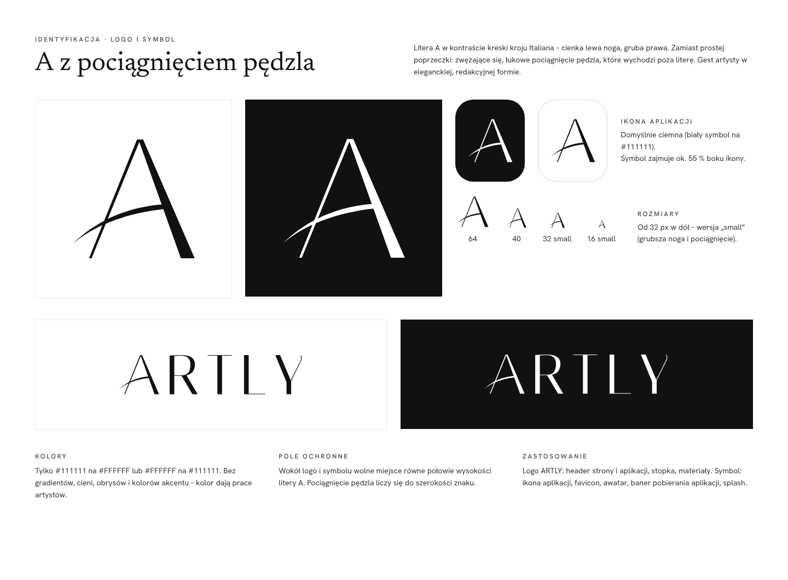

# ARTLY – logo i symbol „A z pociągnięciem pędzla”

**Idea.** Wzór od klienta jest w pliku `wzor_logo_od_klienta.jpg`.
- Litera A ma kontrast kreski kroju Italiana: cienka lewa noga, gruba prawa.
- Zamiast prostej poprzeczki jest zwężające się, łukowe **pociągnięcie pędzla**, które wychodzi w lewo poza literę. To gest artysty w eleganckiej, redakcyjnej formie.
- Logo to ARTLY z tą literą A, a pozostałe litery są z kroju Italiana (zamienione na krzywe, odstępy 0,12 em).
- Symbol to sama litera A.

## Pliki

| Plik | Do czego |
|---|---|
| `svg/artly-logo-black.svg`, `-white.svg` (= `artly-wordmark-*`, `artly-lockup-horizontal-*` z marginesem) | **logo główne**: header strony i aplikacji, stopka, dokumenty |
| `svg/artly-lockup-vertical-*.svg` | symbol nad logo (np. splash, materiały kwadratowe) |
| `svg/artly-symbol-black.svg`, `-white.svg` | symbol A (od 24 px) |
| `svg/artly-symbol-small-*.svg` | symbol do 16–32 px (grubsza lewa noga i pociągnięcie) |
| `png/app-icon-1024-dark.png` | **ikona aplikacji** (App Store / Google Play), domyślna |
| `png/app-icon-1024-light.png` | wariant jasny |
| `png/android-adaptive-foreground-432.png` | Android adaptive icon (tło `#111111`) |
| `png/splash-symbol-white-512.png` | splash screen (tło `#111111`) |
| `png/apple-touch-icon-180.png`, `favicon.ico`, `favicon-16/32/48.png`, `svg/favicon.svg` | strona www |
| `ARTLY_symbol_prezentacja.png` (2x), `ARTLY_symbol_karta.png` | prezentacja logo i symbolu |

## Zasady

- **Kolory:** wyłącznie `#111111` na `#FFFFFF` albo `#FFFFFF` na `#111111`. Bez gradientów, cieni, obrysów i kolorów.
- **Pole ochronne:** wokół logo i symbolu wolne miejsce równe połowie wysokości litery A. Pociągnięcie pędzla liczy się do szerokości znaku.
- **Minimalny rozmiar:**
  - logo: 14 px wysokości liter,
  - symbol: 24 px (wersja podstawowa), 16 px (wersja small).
- **Nie wolno:**
  - składać logo z fontu, bo litera A jest rysowana,
  - zmieniać proporcji, obracać,
  - dodawać tła innego niż biel lub czerń.
- Projekt na canvasie ARTLY: artboard **„Logo i symbol ARTLY”**.
