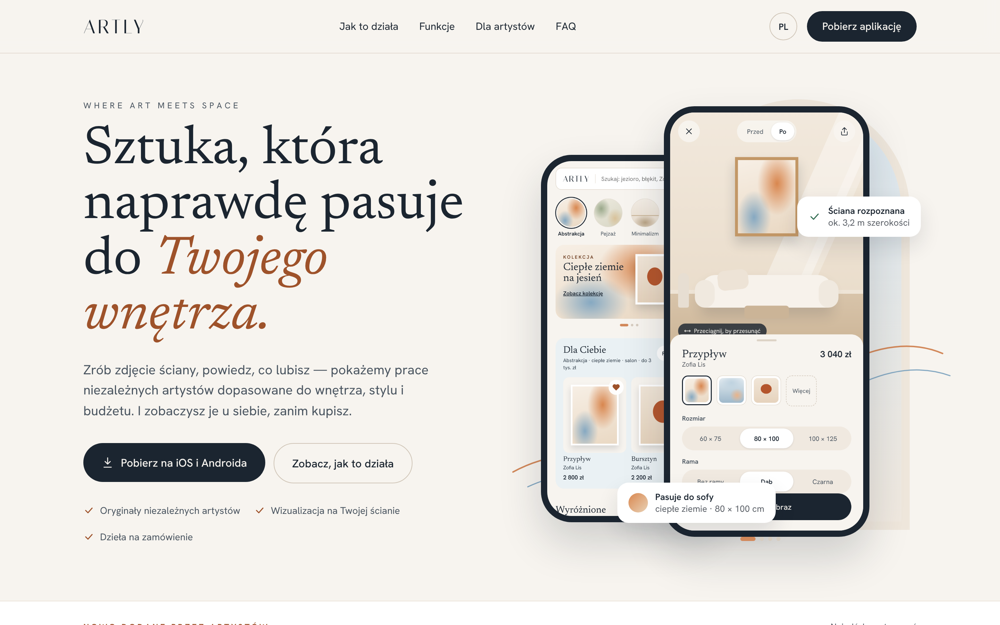
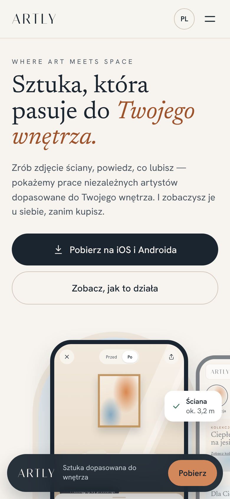
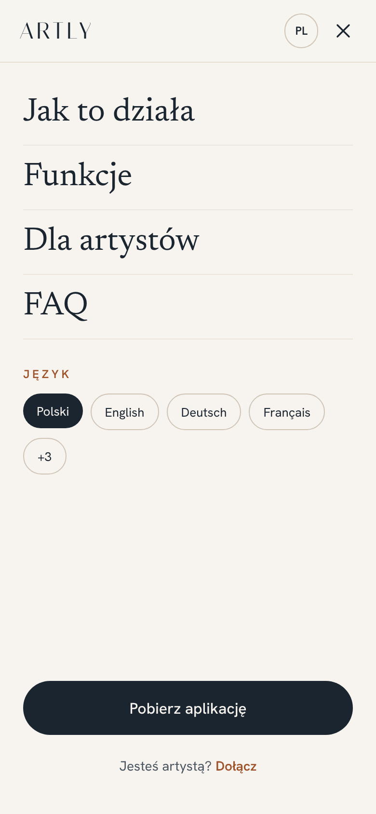

# ARTLY — strona internetowa w Astro: instrukcja wdrożenia

| | |
|---|---|
| Wersja | 1.0 (15.11.2026) |
| Dotyczy | landing page ARTLY (obecnie: artly.piotrchabros.com) — wersja **desktop** i **mobile** z animacjami |
| Projekt (źródło prawdy) | canvas „ARTLY – aplikacja mobilna”: plansze **„Strona — desktop (z animacjami)”** i **„Strona — mobile (z animacjami)”** + karteczki „RUCH / INTERAKCJE”. W trybie Play animacje i karuzele działają — sprawdzaj w nim zachowanie |
| Podglądy w tym folderze | `design/` (zrzuty projektu), `assets/screens/` (ekrany aplikacji do użycia na stronie) |
| Technologia | Astro 7.x (statyczny build), TypeScript, czysty CSS (custom properties), małe skrypty bez frameworka UI |

> Cel: obecna strona jest statyczna i „płaska”. Nowa wersja ma ten sam układ treści, ale dochodzą: animowane wejście hero, zmieniające się ekrany w telefonie, przesuwający się pasek prac (marquee), interaktywne „Jak to działa” i „Funkcje”, karuzele na mobile, pełnoekranowe menu, przyklejony przycisk „Pobierz” na mobile, płynne pojawianie się sekcji przy przewijaniu i przejścia między podstronami.

---

## Spis treści

1. [Podglądy projektu](#1-podglądy-projektu)
2. [Struktura projektu Astro](#2-struktura-projektu-astro)
3. [Tokeny: kolory, fonty, ruch](#3-tokeny-kolory-fonty-ruch)
4. [Breakpointy i układ](#4-breakpointy-i-układ)
5. [Sekcje i komponenty](#5-sekcje-i-komponenty)
6. [Specyfikacja animacji](#6-specyfikacja-animacji)
7. [Implementacja: kod bazowy](#7-implementacja-kod-bazowy)
8. [Przejścia między podstronami](#8-przejścia-między-podstronami)
9. [Obrazy i wydajność](#9-obrazy-i-wydajność)
10. [Wielojęzyczność](#10-wielojęzyczność)
11. [Dostępność](#11-dostępność)
12. [SEO, analityka, wdrożenie](#12-seo-analityka-wdrożenie)
13. [Checklista odbioru](#13-checklista-odbioru)

---

## 1. Podglądy projektu

| Desktop — hero | Mobile — hero | Mobile — menu |
|---|---|---|
|  |  |  |

Całe strony (statyczne zrzuty — ruch opisany w §6):

- Desktop 1440 px: [`design/web-desktop-full.png`](design/web-desktop-full.png)
- Mobile 390 px: [`design/web-mobile-full.png`](design/web-mobile-full.png)

Kolejność sekcji (desktop i mobile tak samo):

1. Header (przyklejony) · 2. Hero · 3. Marquee „Nowo dodane” · 4. Dlaczego ARTLY · 5. Jak to działa · 6. Funkcje (zakładki) · 7. Lokalnie + język · 8. Dla artystów · 9. Gwarancje · 10. FAQ · 11. CTA „Pobierz” · 12. Stopka · (mobile) 13. Przyklejony pasek „Pobierz”.

---

## 2. Struktura projektu Astro

```bash
npm create astro@latest artly-www -- --template minimal --typescript strict
cd artly-www
npm i @fontsource/italiana @fontsource/newsreader @fontsource/hanken-grotesk
npx astro add sitemap
```

```
artly-www/
├─ astro.config.mjs
├─ src/
│  ├─ assets/screens/          # PNG ekranów aplikacji (z folderu assets/screens) → optymalizowane przez astro:assets
│  ├─ i18n/
│  │  ├─ pl.json  en.json  de.json  fr.json  es.json  it.json  nl.json
│  │  └─ index.ts              # t(key, locale), lista języków
│  ├─ layouts/Base.astro       # <html lang>, meta, fonty, ClientRouter, globalne skrypty ruchu
│  ├─ components/
│  │  ├─ Header.astro          # sticky + blur, menu mobilne
│  │  ├─ Phone.astro           # ramka telefonu (img lub stos obrazów)
│  │  ├─ ScreenRotator.astro   # stos ekranów z crossfade (hero, kroki, funkcje)
│  │  ├─ Hero.astro
│  │  ├─ Marquee.astro
│  │  ├─ WhyCards.astro        # desktop: siatka 3 kol. / mobile: karuzela
│  │  ├─ Steps.astro           # stepper z autoplay i paskiem postępu
│  │  ├─ FeatureTabs.astro     # zakładki + telefon
│  │  ├─ LocalLanguages.astro  # 2 karty, cykliczne „Witaj / Hello / …”
│  │  ├─ Artists.astro         # desktop: „wachlarz” telefonów / mobile: karuzela
│  │  ├─ Trust.astro
│  │  ├─ Faq.astro             # <details> z animacją
│  │  ├─ DownloadCta.astro     # gradient w ruchu
│  │  ├─ StickyCta.astro       # tylko mobile
│  │  ├─ Carousel.astro        # wspólny: scroll-snap + kropki (+ strzałki)
│  │  └─ Footer.astro
│  ├─ scripts/
│  │  ├─ reveal.ts  carousel.ts  rotator.ts  tabs.ts  menu.ts  stepper.ts  cycler.ts
│  ├─ styles/
│  │  ├─ tokens.css  base.css  motion.css
│  └─ pages/
│     ├─ index.astro                 # PL (domyślny)
│     ├─ [locale]/index.astro        # en, de, fr, es, it, nl
│     ├─ dla-artystow.astro          # opcjonalna podstrona (patrz §8)
│     ├─ regulamin.astro  polityka-prywatnosci.astro  kontakt.astro
└─ public/ (favicon, og-image.png, apple-app-site-association jeśli potrzebne)
```

`astro.config.mjs`:

```js
import { defineConfig } from 'astro/config';
import sitemap from '@astrojs/sitemap';

export default defineConfig({
  site: 'https://artly.piotrchabros.com', // docelowo domena ARTLY
  output: 'static',
  integrations: [sitemap({ i18n: { defaultLocale: 'pl', locales: { pl: 'pl-PL', en: 'en', de: 'de', fr: 'fr', es: 'es', it: 'it', nl: 'nl' } } })],
  i18n: {
    locales: ['pl', 'en', 'de', 'fr', 'es', 'it', 'nl'],
    defaultLocale: 'pl',
    routing: { prefixDefaultLocale: false },
  },
  image: { responsiveStyles: true },
});
```

> Astro 7 ma nowy kompilator (ostrzejszy wobec niezamkniętych tagów) i usunął część helperów `astro:transitions` — używaj nazw zdarzeń wprost (`astro:page-load`, `astro:after-swap`). Przed startem sprawdź aktualny upgrade guide.

---

## 3. Tokeny: kolory, fonty, ruch

Te same wartości co w aplikacji (PRD §5). `src/styles/tokens.css`:

```css
:root {
  /* kolory */
  --bg: #F7F4EF;           --surface: #FFFFFF;     --sand: #F0E9E0;
  --mat: #EFE6DA;          --blue: #EAF1F4;        --ink: #1B2530;
  --muted: #5A5F66;        --subtle: #4A5560;      --text-blue: #34414D;
  --accent: #D2885A;       --accent-text: #9E522A; --accent-soft: #F2C3A1;
  --on-dark-muted: #C9D2DA;
  --border: #CFC4B6;       --border-soft: #E3DBD0; --divider: #ECE5DB;
  --toggle-off: #D6CCBF;   --success: #2F6B4F;

  /* fonty */
  --font-logo: 'Italiana', serif;
  --font-serif: 'Newsreader', Georgia, serif;
  --font-sans: 'Hanken Grotesk', system-ui, sans-serif;

  /* kształt */
  --r-pill: 999px; --r-card: 24px; --r-card-lg: 32px; --r-phone: 44px;
  --shadow-phone: 0 30px 60px rgba(27,37,48,.18);
  --shadow-card-hover: 0 22px 40px rgba(27,37,48,.12);
  --shadow-chip: 0 14px 30px rgba(27,37,48,.12);

  /* ruch */
  --ease-out: cubic-bezier(.2,.7,.2,1);   /* domyślny dla wejść */
  --ease-io: cubic-bezier(.4,0,.2,1);
  --d-fast: 200ms; --d-base: 350ms; --d-slow: 700ms; --d-enter: 900ms;
}
```

Fonty (w `Base.astro`): importuj tylko używane grubości, subset `latin` + `latin-ext` (polskie znaki):

```astro
---
import '@fontsource/italiana/400.css';
import '@fontsource/newsreader/400.css';
import '@fontsource/newsreader/500.css';
import '@fontsource/newsreader/400-italic.css';
import '@fontsource/hanken-grotesk/400.css';
import '@fontsource/hanken-grotesk/500.css';
import '@fontsource/hanken-grotesk/600.css';
---
```

Skala typografii strony:

| Element | Desktop | Mobile |
|---|---|---|
| H1 hero | Newsreader 400, `clamp(44px, 5.6vw, 78px)`, lh 1.02, ostatnie 2 słowa italic `--accent-text` | 42 / 1.04 |
| H2 sekcji | Newsreader 400, `clamp(34px, 3.8vw, 52px)`, lh 1.08 | 32 / 1.1 |
| H3 | Newsreader 400, 23–42 | 20–28 |
| Overline | Hanken 600, 12, letter-spacing .24em, uppercase, `--accent-text` | 11 |
| Tagline „WHERE ART MEETS SPACE” | Hanken 400, 12, letter-spacing .32em | 11 |
| Tekst | Hanken 400, 16–19 / 1.55, `--subtle` | 15–16 |
| Przyciski | Hanken 500, 16, wys. 56 (desktop) / 54 (mobile), pill | |

---

## 4. Breakpointy i układ

| Zakres | Układ |
|---|---|
| `< 768px` | **mobile** wg planszy mobile: marginesy 20 px, jedna kolumna, karuzele, menu pełnoekranowe, sticky CTA |
| `768–1199px` | tablet: układ desktopowy z `flex-wrap` (hero tekst nad telefonami), siatki 2-kolumnowe, bez karuzel |
| `≥ 1200px` | **desktop** wg planszy desktop, kontener `max-width: 1200px`, padding 24 px |

Zasady:

- Jeden HTML dla wszystkich rozmiarów — różnice tylko przez CSS (komponenty mobilne/desktopowe przełączane klasami `.only-mobile` / `.only-desktop`, gdy układ jest zupełnie inny: „Dlaczego”, „Dla artystów”).
- Brak poziomego przewijania strony (`overflow-x: clip` na `<body>`).
- Animuj **wyłącznie** `transform` i `opacity` (oraz `filter: blur` przy wejściu H1) — zero przesunięć układu (CLS).

---

## 5. Sekcje i komponenty

### 5.1 Header

- `position: sticky; top: 0`, tło `rgba(247,244,239,.82)` + `backdrop-filter: blur(14px)`, dolna linia `rgba(207,196,182,.5)`.
- Desktop: logo · linki (Jak to działa, Funkcje, Dla artystów, FAQ) z podkreśleniem rosnącym od lewej przy hover · przełącznik języka (pill „PL”) · „Pobierz aplikację”.
- Mobile (wys. 64): logo · „PL” · hamburger (2 linie → X). Menu: panel na całą wysokość pod headerem, tło `--bg`, linki Newsreader 34 px z linią podziału, sekcja „Język”, na dole „Pobierz aplikację” + „Jesteś artystą? Dołącz”.
- Linki kotwic przewijają płynnie (`scroll-behavior: smooth` + `scroll-margin-top: 80px` na sekcjach). Kliknięcie linku w menu zamyka menu.

### 5.2 Hero

- Lewa kolumna: tagline → H1 (wejście słowo po słowie) → akapit → 2 przyciski → 3 cechy z ikoną ✓.
- Prawa (desktop): łuk okna (gradient `#DCE8F0 → #F0E9E0`, ramka 12 px `#EFE7DC`), dwie wstęgi SVG rysujące się linią, tylny telefon (Odkrywaj) z animacją „unoszenia z przechyłem”, przedni telefon z **rotatorem 4 ekranów** (Wizualizacja → Odkrywaj → Dzieło → Profil), pod nim klikalne kropki, 2 pływające karty („Ściana rozpoznana · ok. 3,2 m”, „Pasuje do sofy · ciepłe ziemie”).
- Mobile: zamiast dwóch telefonów — **karuzela 4 telefonów** (szer. 220, odstęp 16, padding boczny 85 → aktywny wyśrodkowany, sąsiednie zmniejszone do `scale(.9)` i `opacity .55`), podpis pod telefonem, kropki, tekst „Przesuń, by zobaczyć więcej ekranów”, jedna pływająca karta.

### 5.3 Marquee „Nowo dodane”

- Pasek na białym tle między liniami. Kafle: desktop 180×200, mobile 128×150 (tło `--mat`, dzieło z białym passe-partout), tytuł Newsreader + artysta.
- Lista zduplikowana w HTML (2×), tor przesuwa się `translateX(0 → -50%)` w 46 s (mobile 36 s), liniowo, w nieskończoność. Desktop: pauza po najechaniu, kafel unosi się przy hover.
- Na produkcji kafle = prawdziwe najnowsze prace (np. z API Medusy podczas buildu lub statyczna lista aktualizowana przy deployu).

### 5.4 Dlaczego ARTLY

- Desktop: siatka 3 kart (sand / blue / sand), promień 24, hover: uniesienie 6 px + cień.
- Mobile: karuzela kart 280 px ze snapem `start`, odstęp 12, kropki pod spodem (aktywna 20×6 `--accent`).

### 5.5 Jak to działa (stepper)

- Desktop: po lewej 4 przyciski-kroki (numer w kółku, tytuł, opis, cienki pasek postępu), po prawej telefon w niebieskiej karcie z rotatorem 4 ekranów (Wnętrze, Gust, Wizualizacja, Zakup).
- Aktywny krok: tło `--bg`, obramowanie, przesunięcie `translateX(6px)`, numer w ciemnym kółku, pasek postępu wypełnia się przez 4,5 s; po wypełnieniu → następny krok (pętla).
- Klik w krok: przełącza od razu i wstrzymuje autoplay na 12 s.
- Mobile: kroki jako 4 kolumny z paskami (pasek aktywnego się wypełnia, wcześniejsze pełne), pod spodem telefon, pod nim tytuł i opis aktywnego kroku z animacją wejścia.

### 5.6 Funkcje (zakładki)

- Zakładki-pills (Odkrywaj · Zobacz u siebie · Na wymiar · Twój gust) w kontenerze `--sand`. Mobile: rząd przewijany poziomo.
- Zmiana zakładki: telefon robi crossfade + lekki zoom (`scale(1.04 → 1)`), treść (H3, opis, lista ✓) wjeżdża fade-up 550 ms.
- Treść zakładek w HTML (wszystkie 4 panele, nieaktywne `hidden`) — ważne dla SEO i czytników ekranu.

### 5.7 Lokalnie + język

- 2 karty. Karta „Artyści z Twojej okolicy” (biała) z dwoma unoszącymi się miniaturami dzieł w rogu.
- Karta „W Twoim języku” (ciemna): duże słowo powitania zmienia się co 1,8 s (Witaj → Hello → Hallo → Bonjour → Hola → Ciao → Welkom) z wejściem od dołu; pod spodem chipy 7 języków, chip aktualnego języka podświetlony `--accent-soft`.

### 5.8 Dla artystów

- Ciemna sekcja `--ink`. Desktop: nagłówek + przycisk „Dołącz jako artysta” (terakota), 4 telefony w rzędzie (co drugi obniżony o 48 px) — **efekt wachlarza** przy najechaniu na rząd (skrajne odsuwają się i obracają ±6°, środkowe unoszą się 16 px), pod spodem 4 korzyści.
- Mobile: karuzela 4 telefonów jak w hero (aktywny wyśrodkowany), podpis = tytuł + zdanie korzyści, kropki (na ciemnym tle nieaktywne `rgba(247,244,239,.3)`), przycisk na pełną szerokość.

### 5.9 Gwarancje, FAQ, CTA, stopka

- Gwarancje: 4 kolumny (desktop) / 2×2 (mobile), ikona terakota + tekst.
- FAQ: `<details>`; plus obraca się o 45° (× ), odpowiedź wjeżdża fade-up; płynna wysokość (§7.7).
- CTA: duża karta z gradientem `#F2DCC6 → #EAF1F4 → #F0E9E0 → #E9C7AA`, `background-size: 300%`, powolne przesuwanie (14 s), logo + H2 + 2 przyciski sklepów (docelowo oficjalne odznaki App Store / Google Play zgodnie z wytycznymi sklepów).
- Mobile: **przyklejony pasek** na dole (`position: fixed; bottom: 12px`, ciemny pill z logo, hasłem i przyciskiem „Pobierz”) — pojawia się (slide-up) po minięciu przycisków w hero, chowa się, gdy widoczna jest sekcja CTA.

---

## 6. Specyfikacja animacji

| # | Element | Wyzwalacz | Animacja | Czas / easing | Opóźnienie | Reduced motion |
|---|---|---|---|---|---|---|
| A1 | H1 hero — słowa | załadowanie | `opacity 0→1`, `translateY(60%)→0`, `blur(6px)→0` | 800 ms `--ease-out` | 100 ms + 80 ms × indeks słowa | bez animacji |
| A2 | Tagline, akapit, przyciski, cechy, telefony | załadowanie | fade-up 28 px | 900 ms `--ease-out` | 50 / 700 / 850 / 1000 / 300 ms | bez |
| A3 | Wstęgi SVG | załadowanie | `stroke-dashoffset 900→0` | 2,4 s `--ease-io` | 400 / 700 ms | od razu narysowane |
| A4 | Tylny telefon hero | ciągła | unoszenie 12 px + przechył −5°→−3° | 7 s ease-in-out, pętla | — | statyczny |
| A5 | Pływające karty | ciągła | unoszenie 14 px | 6 s, pętla, przesunięte fazy (−2 s, −4 s) | — | statyczne |
| A6 | Rotator ekranów (hero) | co 3,2 s | crossfade `opacity` 700 ms + `scale(1.04→1)` 900 ms | `--ease-out` | — | brak autoplay, kropki działają |
| A7 | Marquee | ciągła | `translateX(0→-50%)` | 46 s / 36 s liniowo | — | zatrzymany |
| A8 | Sekcje, nagłówki, karty | wejście w widok | fade-up 28 px | 700–900 ms `--ease-out` | stagger 80 ms w grupie | bez |
| A9 | Karty, kafle | hover (desktop) | `translateY(-6px)` + cień / kafel `-8px rotate(-1deg)` | 350–500 ms | — | bez ruchu |
| A10 | Przyciski | hover / active | `translateY(-2px)` + cień / `scale(.98)` | 200 ms | — | bez |
| A11 | Stepper | co 4,5 s | pasek `scaleX(0→1)` liniowo 4,5 s; zmiana kroku: crossfade telefonu + fade-up opisu | 4,5 s / 550 ms | — | brak autoplay |
| A12 | Zakładki funkcji | klik | crossfade telefonu + fade-up panelu | 700 / 550 ms | — | natychmiast |
| A13 | Słowo powitania | co 1,8 s | wejście `translateY(40%)→0` + fade | 500 ms | — | statyczne „Witaj” |
| A14 | Wachlarz artystów | hover rzędu | skrajne `±30px, rotate(±6deg)`, środkowe `-16px` | 600 ms `--ease-out` | — | bez |
| A15 | Karuzele mobile | przewijanie | aktywny `scale(1) opacity 1`, inne `scale(.9) opacity .55`; kropka 6→20 px | 400 ms / 300 ms | — | bez skalowania |
| A16 | Menu mobile | otwarcie | panel fade + `translateY(-12px→0)`; linki kolejno od lewej 16 px | 350 ms / 450 ms | linki co 50 ms | natychmiast |
| A17 | Sticky CTA (mobile) | po minięciu hero | slide-up z `translateY(120%)` | 600 ms | — | natychmiast |
| A18 | Gradient CTA | ciągła | `background-position 0%→100%→0%` | 14 s ease-in-out | — | statyczny |
| A19 | FAQ | otwarcie | plus `rotate(45deg)`, wysokość płynna, odpowiedź fade-up | 300–400 ms | — | natychmiast |
| A20 | Zmiana podstrony | nawigacja | cross-fade + współdzielone logo/telefon (`view-transition-name`) | 300–450 ms | — | brak |

Zasady:

- **Każda** animacja respektuje `prefers-reduced-motion: reduce` (CSS + skrypty nie uruchamiają autoplay).
- Autoplay (rotator, stepper, cykl słów) **zatrzymuje się**, gdy element jest poza ekranem (IntersectionObserver) i gdy karta przeglądarki jest w tle (`visibilitychange`) — oszczędza baterię.
- Rotatory i stepper mają przycisk/kropki — autoplay nigdy nie jest jedynym sposobem zobaczenia treści.

---

## 7. Implementacja: kod bazowy

### 7.1 `src/styles/motion.css`

```css
@keyframes fade-up { from { opacity: 0; transform: translateY(28px); } to { opacity: 1; transform: none; } }
@keyframes word-in { from { opacity: 0; transform: translateY(60%); filter: blur(6px); } to { opacity: 1; transform: none; filter: none; } }
@keyframes float { 0%,100% { transform: translateY(0); } 50% { transform: translateY(-14px); } }
@keyframes float-tilt { 0%,100% { transform: translateY(0) rotate(-5deg); } 50% { transform: translateY(-12px) rotate(-3deg); } }
@keyframes marquee { to { transform: translateX(-50%); } }
@keyframes progress { from { transform: scaleX(0); } to { transform: scaleX(1); } }
@keyframes ribbon { from { stroke-dashoffset: 900; } to { stroke-dashoffset: 0; } }
@keyframes gradient-shift { 0%,100% { background-position: 0% 50%; } 50% { background-position: 100% 50%; } }

/* wejście przy załadowaniu: <span class="enter" style="--delay: 300ms"> */
.enter { opacity: 0; animation: fade-up var(--d-enter) var(--ease-out) var(--delay, 0ms) forwards; }
.word  { display: inline-block; opacity: 0; animation: word-in 800ms var(--ease-out) var(--delay, 0ms) forwards; }

/* wejście w widok: klasa .reveal + JS dodaje .is-in (fallback bez JS: widoczne) */
.js .reveal { opacity: 0; transform: translateY(28px); transition: opacity var(--d-slow) var(--ease-out), transform var(--d-slow) var(--ease-out); transition-delay: var(--stagger, 0ms); }
.js .reveal.is-in { opacity: 1; transform: none; }

.float      { animation: float 6s ease-in-out infinite; }
.float-tilt { animation: float-tilt 7s ease-in-out infinite; }
.marquee__track { display: flex; gap: 20px; width: max-content; animation: marquee 46s linear infinite; }
.marquee:hover .marquee__track { animation-play-state: paused; }
.ribbon { stroke-dasharray: 900; animation: ribbon 2.4s var(--ease-io) .4s both; }
.cta-gradient { background: linear-gradient(120deg, #F2DCC6, #EAF1F4, #F0E9E0, #E9C7AA); background-size: 300% 300%; animation: gradient-shift 14s ease-in-out infinite; }

.lift { transition: transform var(--d-base) var(--ease-out), box-shadow var(--d-base) ease; }
@media (hover: hover) { .lift:hover { transform: translateY(-6px); box-shadow: var(--shadow-card-hover); } }

@media (prefers-reduced-motion: reduce) {
  *, *::before, *::after { animation-duration: .01ms !important; animation-iteration-count: 1 !important; transition-duration: .01ms !important; scroll-behavior: auto !important; }
  .enter, .word, .js .reveal { opacity: 1 !important; transform: none !important; filter: none !important; }
}
```

W `Base.astro` w `<head>` (przed CSS, żeby nie było mignięcia): `<script is:inline>document.documentElement.classList.add('js')</script>`.

### 7.2 Pojawianie się przy przewijaniu — `src/scripts/reveal.ts`

```ts
export function initReveal(root: ParentNode = document) {
  const els = root.querySelectorAll<HTMLElement>('.reveal:not(.is-in)');
  if (!('IntersectionObserver' in window)) { els.forEach(e => e.classList.add('is-in')); return; }
  const io = new IntersectionObserver((entries) => {
    for (const e of entries) if (e.isIntersecting) { e.target.classList.add('is-in'); io.unobserve(e.target); }
  }, { rootMargin: '0px 0px -10% 0px', threshold: 0.1 });
  // stagger w grupach: <div data-stagger> → dzieci .reveal dostają --stagger
  root.querySelectorAll<HTMLElement>('[data-stagger]').forEach(g =>
    g.querySelectorAll<HTMLElement>(':scope > .reveal').forEach((c, i) => c.style.setProperty('--stagger', `${i * 80}ms`)));
  els.forEach(e => io.observe(e));
}
```

(Alternatywa bez JS: CSS `animation-timeline: view()` z `animation-range: entry 0% entry 100%` w `@supports` — działa tylko w części przeglądarek, więc JS jest podstawą.)

### 7.3 Rotator ekranów — `ScreenRotator.astro` + `rotator.ts`

```astro
---
import { Image } from 'astro:assets';
interface Props { shots: { src: ImageMetadata; alt: string }[]; interval?: number; dots?: boolean; id: string }
const { shots, interval = 3200, dots = true, id } = Astro.props;
---
<div class="rotator" data-rotator data-interval={interval} id={id}>
  <div class="screen">
    {shots.map((s, i) => (
      <Image src={s.src} alt={s.alt} widths={[280, 560]} sizes="280px" class:list={['shot', { 'is-active': i === 0 }]}
             loading={i === 0 ? 'eager' : 'lazy'} aria-hidden={i === 0 ? undefined : 'true'} />
    ))}
  </div>
  {dots && <div class="dots" role="tablist" aria-label="Ekrany aplikacji">
    {shots.map((s, i) => <button type="button" role="tab" aria-selected={i === 0 ? 'true' : 'false'} aria-label={s.alt} data-go={i}></button>)}
  </div>}
</div>
<style>
  .screen { position: relative; aspect-ratio: 390 / 844; overflow: hidden; background: var(--bg); }
  .shot { position: absolute; inset: 0; width: 100%; height: 100%; object-fit: cover; object-position: top;
          opacity: 0; transform: scale(1.04); transition: opacity 700ms ease, transform 900ms var(--ease-out); }
  .shot.is-active { opacity: 1; transform: scale(1); }
  .dots { display: flex; justify-content: center; gap: 6px; margin-top: 16px; }
  .dots button { width: 6px; height: 6px; padding: 0; border: 0; border-radius: 6px; background: var(--toggle-off); transition: all .3s ease; cursor: pointer; }
  .dots button[aria-selected='true'] { width: 22px; background: var(--accent); }
  /* klikalny obszar ≥ 24×24 dzięki pseudo-elementowi */
  .dots button { position: relative; } .dots button::after { content: ''; position: absolute; inset: -9px; }
</style>
```

```ts
// rotator.ts — wspólny dla hero, Steps i FeatureTabs (wywołanie: setIndex z zewnątrz)
const reduce = matchMedia('(prefers-reduced-motion: reduce)');

export function initRotators() {
  document.querySelectorAll<HTMLElement>('[data-rotator]').forEach((el) => {
    const shots = [...el.querySelectorAll<HTMLElement>('.shot')];
    const dots = [...el.querySelectorAll<HTMLButtonElement>('[data-go]')];
    const interval = Number(el.dataset.interval) || 3200;
    let i = 0, timer: number | undefined, visible = false;

    const set = (n: number) => {
      i = (n + shots.length) % shots.length;
      shots.forEach((s, k) => { s.classList.toggle('is-active', k === i); s.toggleAttribute('aria-hidden', k !== i); });
      dots.forEach((d, k) => d.setAttribute('aria-selected', String(k === i)));
      el.dispatchEvent(new CustomEvent('rotator:change', { detail: i }));
    };
    const start = () => { stop(); if (!reduce.matches && visible && el.dataset.autoplay !== 'off') timer = window.setInterval(() => set(i + 1), interval); };
    const stop = () => { if (timer) clearInterval(timer); timer = undefined; };

    dots.forEach((d) => d.addEventListener('click', () => { set(Number(d.dataset.go)); start(); }));
    new IntersectionObserver(([e]) => { visible = e.isIntersecting; visible ? start() : stop(); }).observe(el);
    document.addEventListener('visibilitychange', () => (document.hidden ? stop() : start()));
    (el as any).rotator = { set, start, stop };
  });
}
```

### 7.4 Stepper „Jak to działa” — `stepper.ts`

```ts
export function initStepper(root: HTMLElement) {
  const steps = [...root.querySelectorAll<HTMLButtonElement>('[role="tab"]')];
  const rot = (root.querySelector('[data-rotator]') as any)?.rotator;
  const DURATION = 4500;
  let i = 0, timer: number | undefined, pausedUntil = 0;

  const select = (n: number) => {
    i = n % steps.length;
    steps.forEach((s, k) => {
      s.setAttribute('aria-selected', String(k === i));
      s.tabIndex = k === i ? 0 : -1;
      // restart paska postępu: klasa zdejmowana i dodawana w następnej klatce
      const bar = s.querySelector<HTMLElement>('.bar');
      bar?.classList.remove('run'); if (k === i) requestAnimationFrame(() => requestAnimationFrame(() => bar?.classList.add('run')));
    });
    root.querySelectorAll<HTMLElement>('[role="tabpanel"]').forEach((p, k) => (p.hidden = k !== i));
    rot?.set(i);
  };
  steps.forEach((s, k) => s.addEventListener('click', () => { pausedUntil = Date.now() + 12000; select(k); }));
  // klawiatura: ←/→ (mobile) i ↑/↓ (desktop pionowa lista)
  root.addEventListener('keydown', (e) => {
    const d = { ArrowRight: 1, ArrowDown: 1, ArrowLeft: -1, ArrowUp: -1 }[e.key];
    if (d) { e.preventDefault(); pausedUntil = Date.now() + 12000; select((i + d + steps.length) % steps.length); steps[i].focus(); }
  });
  if (!matchMedia('(prefers-reduced-motion: reduce)').matches)
    timer = window.setInterval(() => { if (Date.now() > pausedUntil) select(i + 1); }, DURATION);
  select(0);
}
```

CSS paska: `.bar { transform-origin: left; transform: scaleX(0); } .bar.run { animation: progress 4.5s linear forwards; }`; rotator w stepperze ma `data-autoplay="off"` (steruje nim stepper).

### 7.5 Zakładki funkcji — `tabs.ts`

Wzorzec WAI-ARIA Tabs: `role="tablist"`, przyciski `role="tab"` z `aria-controls`, panele `role="tabpanel"` z `hidden`. Zmiana zakładki: `rotator.set(index)`, panel otrzymuje klasę `.panel-in` (`animation: fade-up 550ms var(--ease-out)`). Strzałki ←/→, Home/End. Na mobile pasek zakładek przewija aktywną do widoku: `tab.scrollIntoView({ inline: 'center', block: 'nearest', behavior: 'smooth' })`.

### 7.6 Karuzela mobile — `Carousel.astro` + `carousel.ts`

Bez bibliotek: natywny `scroll-snap` + kropki + skalowanie aktywnego elementu.

```css
.carousel { display: flex; gap: var(--gap, 16px); overflow-x: auto; scroll-snap-type: x mandatory;
            padding-inline: var(--pad, 85px); scrollbar-width: none; overscroll-behavior-x: contain; }
.carousel::-webkit-scrollbar { display: none; }
.carousel > * { flex: 0 0 var(--item, 220px); scroll-snap-align: var(--align, center);
                transition: transform 400ms var(--ease-out), opacity 400ms ease; }
.carousel[data-scale] > :not(.is-active) { transform: scale(.9); opacity: .55; }
```

```ts
export function initCarousels() {
  document.querySelectorAll<HTMLElement>('[data-carousel]').forEach((track) => {
    const items = [...track.children] as HTMLElement[];
    const dots = [...document.querySelectorAll<HTMLButtonElement>(`[data-dots="${track.id}"] button`)];
    const step = () => items[1] ? items[1].offsetLeft - items[0].offsetLeft : track.clientWidth;
    const update = () => {
      const i = Math.max(0, Math.min(items.length - 1, Math.round(track.scrollLeft / step())));
      items.forEach((el, k) => el.classList.toggle('is-active', k === i));
      dots.forEach((d, k) => d.setAttribute('aria-current', String(k === i)));
    };
    let raf = 0;
    track.addEventListener('scroll', () => { cancelAnimationFrame(raf); raf = requestAnimationFrame(update); }, { passive: true });
    dots.forEach((d, k) => d.addEventListener('click', () => track.scrollTo({ left: k * step(), behavior: 'smooth' })));
    update();
  });
}
```

Parametry z projektu:

| Karuzela | `--item` | `--gap` | `--pad` | `--align` | skalowanie |
|---|---|---|---|---|---|
| Hero (telefony) | 220px | 16px | 85px | center | tak |
| Dlaczego (karty) | 280px | 12px | 20px | start | nie |
| Dla artystów (telefony) | 220px | 16px | 85px | center | tak |
| Zakładki funkcji | auto | 8px | 20px | — (bez snapu) | nie |

Na desktopie (`≥ 768px`) te same listy są zwykłymi siatkami (`display: grid`) — karuzela tylko na mobile.

### 7.7 FAQ z płynną wysokością

```css
details { interpolate-size: allow-keywords; }
details::details-content { block-size: 0; overflow: hidden; transition: block-size 350ms var(--ease-out), content-visibility 350ms allow-discrete; }
details[open]::details-content { block-size: auto; }
details .plus { transition: transform 300ms ease; } details[open] .plus { transform: rotate(45deg); }
```

Przeglądarki bez `::details-content` po prostu otwierają bez animacji (akceptowalne).

### 7.8 Menu mobilne — `menu.ts`

- Przycisk `aria-expanded`, `aria-controls="mobile-menu"`; menu `<nav id="mobile-menu" hidden>`.
- Otwarcie: `hidden = false`, klasa `.is-open` (animacja A16), `document.body.style.overflow = 'hidden'`, fokus na pierwszy link, **pułapka fokusu** (Tab krąży w menu), `Esc` zamyka i zwraca fokus na przycisk.
- Kliknięcie linku kotwicy: zamknij menu, potem przewiń.
- Na `astro:after-swap` (zmiana strony) menu zawsze zamknięte.

### 7.9 Sticky CTA (mobile)

```ts
const bar = document.querySelector<HTMLElement>('.sticky-cta');
const heroCtas = document.querySelector('#hero-ctas'), finalCta = document.querySelector('#pobierz');
if (bar && heroCtas && finalCta) {
  let pastHero = false, atEnd = false;
  const render = () => bar.classList.toggle('is-visible', pastHero && !atEnd);
  new IntersectionObserver(([e]) => { pastHero = !e.isIntersecting && e.boundingClientRect.top < 0; render(); }).observe(heroCtas);
  new IntersectionObserver(([e]) => { atEnd = e.isIntersecting; render(); }).observe(finalCta);
}
```

```css
.sticky-cta { position: fixed; left: 12px; right: 12px; bottom: calc(12px + env(safe-area-inset-bottom));
              transform: translateY(140%); transition: transform 600ms var(--ease-out); z-index: 40; }
.sticky-cta.is-visible { transform: none; }
@media (min-width: 768px) { .sticky-cta { display: none; } }
```

Stopka mobile ma dolny padding ≥ 96 px, żeby pasek nie zasłaniał linków.

### 7.10 Inicjalizacja (w `Base.astro`)

```astro
<script>
  import { initReveal } from '../scripts/reveal';
  import { initRotators } from '../scripts/rotator';
  import { initCarousels } from '../scripts/carousel';
  import { initStepper } from '../scripts/stepper';
  import { initTabs } from '../scripts/tabs';
  import { initMenu } from '../scripts/menu';
  import { initCycler } from '../scripts/cycler';
  document.addEventListener('astro:page-load', () => {   // działa przy pierwszym wejściu i po każdej nawigacji ClientRouter
    initReveal(); initRotators(); initCarousels(); initTabs(); initMenu(); initCycler();
    document.querySelectorAll<HTMLElement>('[data-stepper]').forEach(initStepper);
  });
</script>
```

Każda funkcja `init*` musi być idempotentna (np. znacznik `data-ready` na elemencie), bo `astro:page-load` odpala się po każdej nawigacji.

---

## 8. Przejścia między podstronami

Strona główna jest jedną długą stroną z kotwicami; podstrony: **Dla artystów** (rozszerzona wersja sekcji 8 — opcjonalnie), **Regulamin**, **Polityka prywatności**, **Kontakt**, wersje językowe.

- Włącz `<ClientRouter />` z `astro:transitions` w `Base.astro` — nawigacja bez przeładowania z animacją cross-fade (300 ms).
- Współdzielone elementy: logo w headerze `transition:name="logo"` (pozostaje w miejscu), przedni telefon z hero → telefon na podstronie „Dla artystów” `transition:name="phone-main"` (płynnie przelatuje).
- Linki do kotwic na tej samej stronie — zwykłe płynne przewijanie, bez view transition.
- Prostsza alternatywa bez ClientRouter: natywne przejścia między dokumentami w CSS `@view-transition { navigation: auto; }` + te same `view-transition-name` (działa w nowych przeglądarkach, w innych — zwykłe przejście).
- `prefers-reduced-motion`: przejścia wyłączone (`::view-transition-group(*) { animation: none; }`).

---

## 9. Obrazy i wydajność

- Ekrany aplikacji z `assets/screens/` → `src/assets/screens/` i wyłącznie przez `astro:assets` (`<Image>` / `<Picture formats={['avif','webp']}>`), `widths` dopasowane do ramki (np. 220/280/440/560), `sizes` z faktyczną szerokością telefonu.
- LCP: przedni telefon hero — pierwszy obraz `loading="eager"` + `fetchpriority="high"`, pozostałe `lazy`.
- Ramka telefonu w CSS (border 9 px desktop / 7 px mobile, promień 44/36), nie jako obraz.
- Kafle w marquee i dzieła dekoracyjne: na produkcji prawdziwe zdjęcia prac (WebP ≤ 400 px szer.), `decoding="async"`.
- Budżety: JS strony ≤ 15 kB gz (bez frameworków UI), CSS ≤ 30 kB gz, LCP < 2,5 s na 4G, CLS < 0,05, INP < 200 ms. Fonty: tylko użyte grubości, `font-display: swap`, preload Newsreader 400 i Hanken 400.
- Animacje ciągłe (marquee, float, gradient) — tylko `transform`/`opacity`/`background-position`; `will-change` tylko na torze marquee.

---

## 10. Wielojęzyczność

Te same 7 języków co aplikacja: **pl** (domyślny, bez prefiksu), **en**, **de**, **fr**, **es**, **it**, **nl** (`/en/`, `/de/`…).

- Teksty w `src/i18n/{locale}.json` (klucze per sekcja: `hero.title`, `steps.1.title`…); helper `t(key)`; żadnych tekstów na sztywno w komponentach.
- H1 dzielone na słowa w komponencie (dla animacji A1) — `title.split(' ')` + osobny klucz `hero.titleAccentWords` (liczba końcowych słów wyróżnionych italic), bo kolejność słów różni się między językami.
- `<html lang>` z locale, `<link rel="alternate" hreflang>` dla wszystkich wersji + `x-default`.
- Przełącznik języka w headerze (desktop: pill „PL” z listą; mobile: sekcja „Język” w menu) — prowadzi do tej samej sekcji w innym języku (`getRelativeLocaleUrl`).
- Pierwsza wizyta: jeśli `navigator.languages` wskazuje inny obsługiwany język niż aktualna wersja → **dyskretny pasek** „Ta strona jest dostępna po niemiecku — Przełącz” (nie automatyczne przekierowanie, ze względu na SEO); wybór zapamiętany w `localStorage`.
- Słowo w karcie „W Twoim języku” (A13) zaczyna od powitania w języku strony.
- Zrzuty ekranów aplikacji: na start polskie; docelowo osobne zestawy per język (`src/assets/screens/{locale}/`).

---

## 11. Dostępność

- Kontrast wg tokenów (tekst `--subtle`/`--muted` na `--bg` ≥ 4.5:1; na ciemnym tle `--on-dark-muted`).
- Wszystkie elementy klikalne ≥ 44×44 px na mobile; kropki karuzel z powiększonym obszarem kliknięcia.
- Rotator/stepper/zakładki: poprawne role ARIA, sterowanie klawiaturą, nieaktywne ekrany `aria-hidden`; autoplay zatrzymuje się po fokusie w sekcji (`focusin`) i wznawia po `focusout`.
- Marquee: `aria-hidden="true"` dla zduplikowanej połowy listy; całość zatrzymana przy reduced motion.
- `prefers-reduced-motion` — patrz §6.
- Obrazy ekranów z opisowym `alt` (z i18n), dekoracje (`łuk`, wstęgi, miniatury) `aria-hidden`.
- Link „Przejdź do treści” na początku strony.

---

## 12. SEO, analityka, wdrożenie

- Meta title/description per język, OpenGraph/Twitter z grafiką `og-image.png` (1200×630: hero z telefonem), `@astrojs/sitemap`, `robots.txt`.
- Dane strukturalne JSON-LD `MobileApplication` (nazwa, system iOS/Android, kategoria Lifestyle/Shopping) — uzupełnić po publikacji w sklepach (ID aplikacji, linki).
- Analityka (np. PostHog/Plausible, bez cookies lub z banerem zgód): zdarzenia `cta_download_click` (`store`: ios/android, `placement`: header/hero/sticky/final), `artist_cta_click`, `feature_tab_change`, `step_change`, `faq_open`, `language_change`.
- Linki „Pobierz”: do czasu publikacji w sklepach — zapis na listę oczekujących (formularz e-mail) albo strona „Wkrótce”; po publikacji Smart App Banner (iOS) i deep link do sklepu wg systemu (`navigator.userAgent` tylko do wyboru linku, nie do treści).
- Hosting statyczny (Cloudflare Pages / Netlify / Vercel lub obecny serwer): `npm run build` → `dist/`, nagłówki cache: assets z hashem `max-age=31536000, immutable`, HTML `no-cache`.

---

## 13. Checklista odbioru

- [ ] Desktop 1440 px i mobile 390 px wyglądają jak plansze projektu (porównanie nakładką; odchyłki > 4 px do poprawy).
- [ ] Tablet 768–1199 px: brak poziomego scrolla, sekcje zawijają się czytelnie.
- [ ] Animacje A1–A20 działają zgodnie z tabelą; przy `prefers-reduced-motion` strona jest statyczna i kompletna.
- [ ] Rotatory, stepper, cykl słów zatrzymują się poza ekranem i w tle karty.
- [ ] Karuzele mobile: snap, aktywny element wyśrodkowany i powiększony, kropki zsynchronizowane i klikalne.
- [ ] Menu mobile: animacja, pułapka fokusu, Esc, blokada przewijania tła, zamykanie po kliknięciu linku.
- [ ] Sticky CTA pojawia się po hero i chowa przy sekcji „Pobierz”; nie zasłania stopki.
- [ ] Zakładki i stepper obsługiwane klawiaturą; czytnik ekranu ogłasza aktywny krok/zakładkę.
- [ ] 7 wersji językowych, hreflang, przełącznik języka, pasek sugestii języka.
- [ ] Lighthouse mobile ≥ 90 (Performance, Accessibility, Best Practices, SEO); CLS < 0,05.
- [ ] Brak błędów w konsoli po nawigacji ClientRouter (idempotentne `init*`).
- [ ] Deklaracje na stronie (14 dni zwrotu, certyfikat, ubezpieczona dostawa, metody płatności) potwierdzone biznesowo/prawnie przed publikacją.
